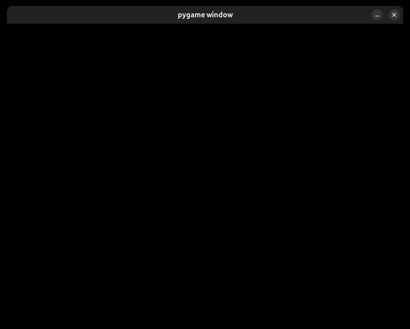
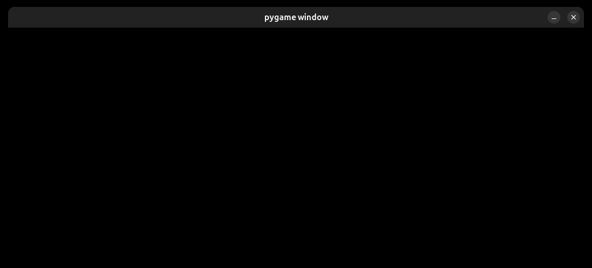
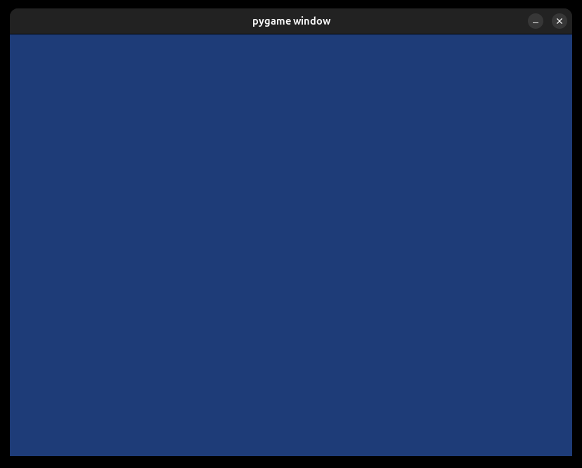
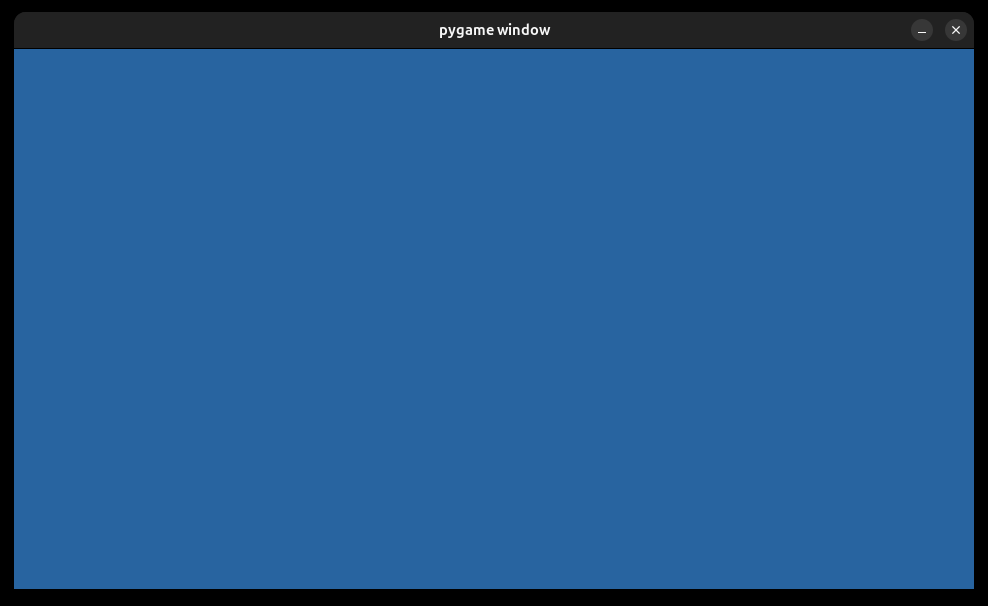

# Урок 1. Первое окно и игровой цикл

Постепенно собираем базовый код Pygame: создаем окно, добавляем цикл, получаем события, обрабатываем закрытие и рисуем фон.

## Степ 1. Создаем окно. Почему оно исчезает?

Сегодня ты соберешь основу игры: окно, которое остается открытым, реагирует на крестик и показывает выбранный фон. Будем добавлять код постепенно и запускать программу после каждого изменения.

Работай в редакторе на своем компьютере, где уже установлен Pygame. Создай файл `main.py`. Не называй его `pygame.py`: такое имя помешает подключить библиотеку. Здесь пригодятся знакомые тебе переменные, условия и циклы Python.

Напиши всего две строки и запусти файл:

```python
import pygame
screen = pygame.display.set_mode((800, 600))
```

`import pygame` подключает библиотеку для создания игр. `pygame.display.set_mode((800, 600))` создает окно, а в `screen` мы сохраняем поверхность, на которой будем рисовать.

**Что произошло?** Окно появилось и сразу исчезло? Иногда оно закрывается так быстро, что ты даже не успеваешь его заметить.

**Почему?** Python выполнил первую строку, затем вторую и дошел до конца файла. Программа закончилась, поэтому ее окно тоже закрылось. Команда создания окна сама по себе не удерживает программу запущенной.

Нам нужно, чтобы после создания окна программа продолжала работать. Для этого добавим цикл.

## Степ 2. Удерживаем программу: while True и pass

Добавь после создания окна бесконечный цикл:

```python
import pygame
screen = pygame.display.set_mode((800, 600))

while True:
    pass  # Заглушка: ничего не делает
```

`while` повторяет команды, пока условие истинно. `True` — это «истина», поэтому условие здесь всегда выполняется и цикл повторяется снова и снова.

После двоеточия у цикла обязательно должно быть тело — хотя бы одна команда с отступом. Пока выполнять нечего, пишем `pass`. Эта команда ничего не делает: это заглушка, чтобы тело цикла не было пустым и Python не выдал ошибку.

**Запусти программу.** Теперь Python доходит до цикла и остается в нем. Окно больше не исчезает сразу после запуска. `pass` не ждет и не приостанавливает программу: цикл быстро повторяет пустое действие.

Обрати внимание: создание окна находится **перед циклом** и выполняется один раз. Команды внутри `while` повторяются много раз.

> **Как остановить этот пример**
>
> Пока закрывай программу кнопкой «Стоп» в редакторе. Если запускаешь файл из терминала, вернись в терминал и нажми Ctrl+C. Крестик окна мы запрограммируем чуть позже.



Окно 800×600 после добавления while True: программа продолжает работать. Рамка окна в размер области для рисования не входит.

## Степ 3. Размер окна и первые проблемы

Посмотри на строку `screen = pygame.display.set_mode((800, 600))`.

Пара `(800, 600)` задает размер области для рисования в пикселях: первое число — **ширина**, второе — **высота**. Пиксель — одна маленькая точка изображения. Рамка и заголовок окна в эти размеры не входят.

**Попробуй:** останови программу, замени размер на `(1000, 400)` и запусти снова. Окно станет шире и ниже. Затем верни `(800, 600)`.

Попробуй переместить окно, перекрыть его другим окном и нажать на крестик. Оно может плохо перерисовываться, зависать или получить отметку «Не отвечает». Конкретный вид проблемы зависит от операционной системы.

**Почему цикл не помог со всем сразу?** Он только удерживает программу запущенной. Внутри него мы ничего не делаем и не получаем сообщения от системы. Перемещения мыши, нажатия клавиш и запрос закрытия приходят в виде **событий**. Pygame нужно регулярно получать их из очереди.

Останови программу через редактор или терминал. На следующем шаге заменим пустую заглушку полезной командой.



После замены размера на (1000, 400) окно стало шире и ниже. Сравни с окном из предыдущего степа.

## Степ 4. Получаем события — пока без for

Удали `pass` и на его месте напиши `events = pygame.event.get()`. Пока не добавляй ни перебор, ни проверку событий.

```python
import pygame
screen = pygame.display.set_mode((800, 600))

while True:
    events = pygame.event.get()
```

`pygame.event.get()` получает накопившиеся события из очереди и удаляет полученные события из нее. Список этих событий сохраняется в переменной `events`. Если событий нет, список будет пустым.

Вызов также позволяет Pygame обслуживать системные сообщения окна. Мы вызываем его **внутри `while`**, поэтому это происходит на каждом проходе цикла. Вынести эту строку перед циклом нельзя: тогда события будут получены лишь один раз.

**Запусти и сравни.** Окно должно перестать зависать из-за отсутствия обслуживания событий. Попробуй снова переместить его или переключиться между окнами.

**А почему крестик все еще не завершает программу?** Мы получили события, но пока не написали, что делать с каждым из них. Запрос закрытия тоже попадает в `events`, а наша программа его никак не проверяет. Получить событие и выполнить нужное действие — разные шаги.

> **Остановка пока прежняя**
>
> До добавления проверки закрытия используй кнопку «Стоп» в редакторе или Ctrl+C в терминале.

## Степ 5. Смотрим, какие события лежат в events

В `events` может оказаться сразу несколько событий. Чтобы посмотреть на каждое, добавим знакомый цикл `for`:

```python
import pygame
screen = pygame.display.set_mode((800, 600))

while True:
    events = pygame.event.get()
    for event in events:
        print(event)
```

`for event in events:` по очереди берет события из списка. На каждом проходе `event` — одно конкретное событие, а `events` — весь список, полученный на текущем проходе `while`.

`print(event)` выводит событие в терминал. Запусти программу, подвигай мышью внутри окна, нажми клавишу, затем нажми на крестик. Посмотри, как появляются сообщения. Их точный вид может различаться — заучивать его не нужно.

Когда список пуст, тело `for` не выполняется ни разу. Затем начинается следующий проход `while`, и программа получает новую порцию событий.

Пока мы только печатаем события. Чтобы крестик работал, нужно распознать событие закрытия и завершить программу.

## Степ 6. Учимся закрывать окно по крестику

Удали временный `print(event)`. Вместо него проверь тип события:

```python
import pygame
screen = pygame.display.set_mode((800, 600))

while True:
    events = pygame.event.get()
    for event in events:
        if event.type == pygame.QUIT:
            exit()
```

`event.type` — тип текущего события. `pygame.QUIT` обозначает запрос закрытия окна. В условии `==` сравнивает эти значения.

При нажатии на крестик система отправляет запрос закрытия. Мы получаем его, находим при переборе и вызываем `exit()`, чтобы завершить программу. Вместе с программой закрывается и окно.

Разбери отступы: `events = ...` и `for` находятся внутри `while`; `if` — внутри `for`; `exit()` — внутри `if`. Завершать программу нужно только при событии закрытия, поэтому `exit()` нельзя ставить просто в тело `while` или `for`.

**Проверь:** движение мыши не завершает программу, а нажатие на крестик закрывает окно. Теперь останавливать ее через редактор больше не требуется.

## Степ 7. Готовим модули Pygame к работе

У нас уже работает окно и его закрытие. Добавим перед созданием окна обычную строку подготовки Pygame:

```python
import pygame

pygame.init()
screen = pygame.display.set_mode((800, 600))

while True:
    events = pygame.event.get()
    for event in events:
        if event.type == pygame.QUIT:
            exit()
```

`pygame.init()` инициализирует доступные модули библиотеки: подготавливает их к работе. Это пригодится, когда мы начнем использовать другие возможности Pygame, например текст и звук.

**Почему окно открывалось и без этой строки?** При вызове `pygame.display.set_mode()` модуль окна инициализируется автоматически. Но это не означает, что так же подготовлены все остальные модули. Поэтому в базовом коде будем явно вызывать `pygame.init()` сразу после `import pygame`.

Инициализация выполняется один раз, **перед `while`**. Внутри игрового цикла повторять ее не нужно.

## Степ 8. Заливаем фон и показываем кадр

Теперь сами зададим цвет фона. Добавь `screen.fill((0, 0, 0))` в начало тела `while`, перед получением событий. В конец тела `while`, после всего цикла `for`, добавь `pygame.display.update()`.

```python
import pygame

# Инициализация модулей Pygame
pygame.init()

# Создание окна: ширина 800, высота 600 пикселей
screen = pygame.display.set_mode((800, 600))

while True:
    # Подготовка фона нового кадра
    screen.fill((0, 0, 0))

    # Получение и проверка событий
    events = pygame.event.get()
    for event in events:
        if event.type == pygame.QUIT:
            exit()

    # Показ подготовленного кадра
    pygame.display.update()
```

`screen.fill((0, 0, 0))` заполняет поверхность выбранным цветом. Три числа задают количество красного, зеленого и синего — это запись цвета **RGB**. Каждое число находится в пределах от 0 до 255. `(0, 0, 0)` — черный, `(255, 255, 255)` — белый, `(255, 0, 0)` — красный.

`pygame.display.update()` показывает подготовленное изображение в окне. Без аргументов эта команда обновляет всю область окна. Изменение поверхности и показ изображения — два отдельных действия.

**Попробуй:** замени черный цвет на `(30, 60, 120)`, перезапусти программу и посмотри на синий фон. Так ты заметишь результат, даже если до добавления заливки окно уже выглядело черным. Затем верни `(0, 0, 0)`.

Заливка начинает новый кадр с чистого фона. Когда появятся персонажи, мы будем рисовать их после заливки и до `pygame.display.update()`. Так прежнее изображение не будет оставлять следы.

Обновление экрана находится внутри `while`, на одном уровне с `screen.fill` и `for`. Если поместить его внутрь `for`, в проходах без событий кадр вообще не будет показываться.



Результат опыта с screen.fill((30, 60, 120)) и pygame.display.update(): вся область окна заполнена синим цветом.

## Степ 9. Как работает весь базовый код

Вернись к полному коду предыдущего степа и проследи выполнение сверху вниз.

**Один раз при запуске:** подключаем Pygame, подготавливаем модули, создаем окно и сохраняем поверхность в `screen`.

**Снова и снова внутри `while`:** заполняем фон → получаем события → проверяем каждое событие → показываем кадр. При запросе закрытия выполняется `exit()`, и программа завершается.

Этот повторяющийся участок называется **игровым циклом**. Сейчас в нем только фон и события. Позже здесь появятся изменение положения персонажей, столкновения и рисование объектов.

Два цикла выполняют разную работу: `while True` поддерживает работу всей игры, а `for event in events` перебирает только события текущего прохода. Даже если событий нет, `while` продолжает работать.

**Объясни своими словами:** почему создание окна находится перед циклом, а получение событий и показ кадра — внутри него?

## Степ 10. Практика: настрой свое окно

Измени собранную программу самостоятельно:

1. Сделай область окна шириной **960** и высотой **540** пикселей.
2. Задай фон **`(40, 100, 160)`**.
3. Сохрани получение событий в переменную `events`, перебор через `for` и закрытие по крестику.
4. Запусти программу: окно должно оставаться открытым, показывать выбранный цвет и закрываться при нажатии на крестик.

Запускай файл на своем компьютере. В этом упражнении результат проверяется по поведению окна, а не по выводу в терминал.

**Проверь перед завершением:** размеры идут в порядке «ширина, высота»; цвет записан тройкой чисел; получение событий и обновление экрана находятся внутри `while`; `exit()` выполняется только при `pygame.QUIT`.

Когда все заработает, сохрани этот файл: он станет основой следующих уроков.



Ожидаемый вид окна из практики: область 960×540 и фон RGB (40, 100, 160).

## Степ 11. Проверь, что ты понял

## Сможешь объяснить, как работает твое окно?

Попробуй ответить на вопросы своими словами. Важнее понять причину происходящего, чем запомнить названия команд. Если сомневаешься, вернись к своему файлу и проследи, какие строки Python выполняет по порядку.

### Вопросы для самопроверки

1. Ты создал окно двумя строками, но оно сразу исчезло. Почему? Как добавление `while True` меняет поведение программы?
2. Внутри `while True` стоит только `pass`. Делает ли он паузу? Почему окно может получить отметку «Не отвечает»?
3. Ты заменил `(800, 600)` на `(1000, 400)`. Как изменится форма окна? Нужно ли для этого создавать окно на каждом проходе цикла?
4. В чем разница между `events` и `event`? Что произойдет с циклом `for`, если новых событий нет?
5. После добавления `pygame.event.get()` окно перестало зависать, но крестик не завершает программу. Какой части кода еще не хватает?
6. Что произойдет, если поставить `exit()` сразу внутри `for`, без проверки типа события? Почему здесь так важны отступы?
7. Ты вызвал `screen.fill((30, 60, 120))`. Какая команда должна показать новый фон? Почему ее нужно поставить после `for`, а не внутри него?

---

## Разбор ответов

Сравни со своими объяснениями. Если ответ отличается, найди конкретную строку кода, которая поможет разобраться.

### 1. Почему окно исчезает?

Python выполняет команды сверху вниз. В короткой программе он подключает Pygame, создает окно и доходит до конца файла. На этом программа заканчивается, и ее окно закрывается.

`while True` добавляет повторяющийся участок. Условие `True` всегда истинно, поэтому после выполнения тела цикла Python возвращается к его началу. Программа продолжает работать, пока мы ее не остановим или не выполним команду завершения.

Создание окна остается **перед циклом**: окно нужно создать один раз, а затем работать с ним.

> **Главная мысль**
>
> Создать окно и поддерживать работу программы — разные задачи. Окно появляется благодаря `pygame.display.set_mode(...)`, а повторение действий организует `while True`.

### 2. Что делает pass и почему окно зависает?

`pass` — пустая команда. Она нужна, когда Python требует тело конструкции, а полезные действия мы пока не написали. После `pass` выполнение сразу продолжается: ни ожидания, ни паузы эта команда не создает.

Цикл с одним `pass` быстро повторяется, но не получает сообщения окна. Поэтому система может решить, что приложение зависло, и показать «Не отвечает». Внешние признаки зависят от операционной системы.

Когда мы заменяем заглушку на `events = pygame.event.get()`, у цикла появляется полезная работа: регулярно получать события и обслуживать системные сообщения окна. Оставлять `pass` рядом с этой строкой уже незачем.

> **Не перепутай**
>
> `pass` ничего не делает. `pygame.event.get()` получает события. Ни одна из этих команд сама по себе не задает паузу между кадрами.

### 3. Как читаются размеры окна?

В паре `(1000, 400)` первое число — ширина области для рисования, второе — высота. По сравнению с `(800, 600)` ширина **увеличится на 200 пикселей**, а высота **уменьшится на 200 пикселей**: получится более вытянутое по горизонтали окно. Рамка и заголовок в эти размеры не входят.

Для нашего опыта достаточно поменять числа в строке создания окна и перезапустить файл:

```python
screen = pygame.display.set_mode((1000, 400))
```

Эта строка остается перед `while`. Повторять создание окна на каждом проходе игрового цикла не требуется: в цикле мы получаем события и обновляем изображение уже созданного окна.

### 4. Чем отличаются events и event?

`events` — список событий, которые мы получили на текущем проходе `while`. В нем может быть несколько событий, одно событие или вообще ни одного.

`event` — одно событие из этого списка. Цикл `for` по очереди присваивает переменной `event` каждый элемент и выполняет для него свое тело.

```python
while True:
    events = pygame.event.get()
    for event in events:
        print(event)
```

> **А если событий нет?**
>
> `events` будет пустым списком `[]`. Тело `for` не выполнится ни разу, но вся программа не остановится: `while` начнет следующий проход и снова получит события. Здесь `print(event)` нужен только для наблюдения за ними.

### 5. Почему получение событий не включает крестик автоматически?

`pygame.event.get()` сообщает программе о произошедшем, но не решает за нас, как реагировать. Нажатие на крестик дает событие с типом `pygame.QUIT` — **запрос на закрытие**.

Нужно перебрать полученные события, сравнить тип каждого с `pygame.QUIT` и только при совпадении вызвать `exit()`:

```python
events = pygame.event.get()
for event in events:
    if event.type == pygame.QUIT:
        exit()
```

> **Три шага обработки**
>
> **Получить** список событий → **найти** событие закрытия → **завершить** программу. Если выполнить только первый шаг, запрос будет получен, но нужное действие так и не произойдет.

### 6. Почему нельзя завершать программу при любом событии?

События приходят не только от крестика. Например, событие может появиться при движении мыши, нажатии клавиши или изменении состояния окна.

Если поставить `exit()` в тело `for` без `if`, программа завершится при **первом полученном событии**, каким бы оно ни было. Служебные события могут приходить уже при создании окна — тогда оно снова быстро исчезнет.

В рабочем коде каждый следующий отступ уточняет, когда выполняется команда:

```python
while True:                           # Повторяем работу игры
    events = pygame.event.get()       # Получаем события этого прохода
    for event in events:              # Проверяем каждое событие
        if event.type == pygame.QUIT: # Только запрос на закрытие
            exit()                    # Завершаем программу
```

`exit()` находится внутри `if`, поэтому движение мыши само по себе не закрывает игру. Если поставить `exit()` просто в тело `while`, программа завершится уже на первом проходе, даже если событий вообще нет.

### 7. Чем заливка отличается от показа кадра?

`screen.fill((30, 60, 120))` заполняет поверхность цветом. Три числа задают количество красного, зеленого и синего. Мы подготовили фон, но для показа изменений нужно вызвать `pygame.display.update()`.

Обе команды выполняются на каждом проходе `while`: сначала готовим изображение, затем показываем его. Получение и проверка событий находятся между ними:

```python
while True:
    screen.fill((30, 60, 120))

    events = pygame.event.get()
    for event in events:
        if event.type == pygame.QUIT:
            exit()

    pygame.display.update()
```

> **Обрати внимание на отступ**
>
> `pygame.display.update()` стоит на одном уровне с `screen.fill(...)` и `for`, внутри `while`. Если перенести обновление в тело `for`, оно будет зависеть от наличия событий. При пустом списке событий `for` пропустится, и подготовленный кадр не будет показан на этом проходе.
