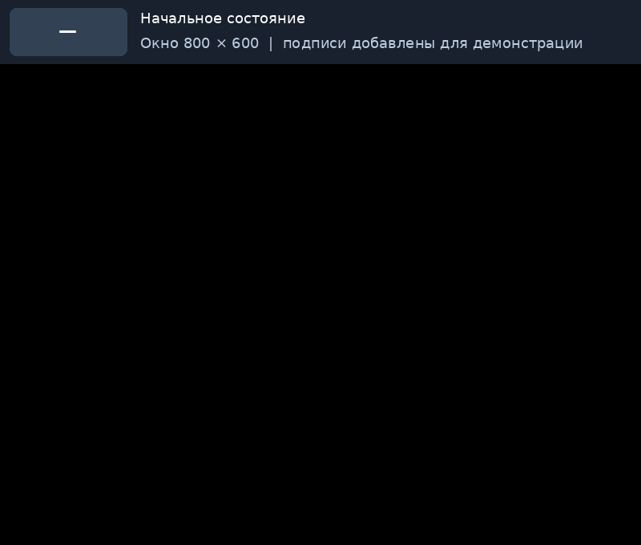
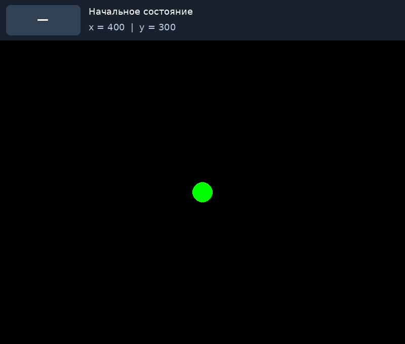
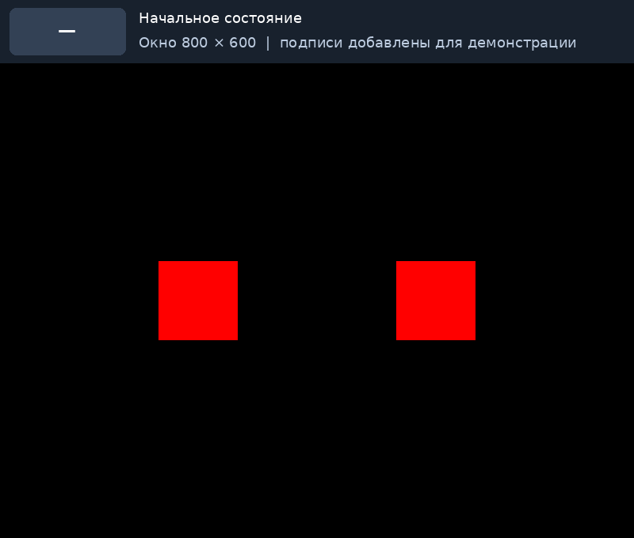

# Урок 4. Клавиатура: реагируем на нажатия

Событие pygame.KEYDOWN, определение клавиши через event.key, смена цвета экрана и движение круга по отдельным нажатиям. Домашнее задание: два цветных квадрата.

## Степ 1. Первое нажатие: pygame.KEYDOWN

В прошлом уроке круг двигался сам: координата менялась на каждом проходе `while`. Теперь программа будет ждать действий игрока. Научимся менять цвет экрана и передвигать круг отдельными нажатиями.

Создай новый файл `main.py` в редакторе на своем компьютере с установленным Pygame. Вспомним: `pygame.event.get()` получает события, а `for event in events` перебирает их. Крестик окна дает событие `pygame.QUIT`. Нажатие клавиши дает другое событие — **`pygame.KEYDOWN`**.

Запусти программу, щелкни внутри ее окна, затем несколько раз нажми любую клавишу. Смотри в консоль редактора:

```python
import pygame

pygame.init()
screen = pygame.display.set_mode((800, 600))

while True:
    events = pygame.event.get()
    for event in events:
        if event.type == pygame.QUIT:
            exit()
        if event.type == pygame.KEYDOWN:
            print("Клавиша нажата!")

    screen.fill((0, 0, 0))
    pygame.display.update()
```

При каждом отдельном нажатии появляется строка «Клавиша нажата!». Пока ты ничего не нажимаешь, новые строки не появляются, хотя `while` продолжает работать.

`event.type` сообщает, что произошло. Проверка `event.type == pygame.KEYDOWN` означает: «это событие нажатия клавиши?». Здесь `==` сравнивает значения, а `=` присваивает значение переменной. `KEYDOWN` пишется заглавными буквами.

> **Нажал, отпустил, нажал снова**
>
> В этом уроке работаем с отдельными нажатиями. По умолчанию в Pygame повтор KEYDOWN при удержании выключен. Не включай pygame.key.set_repeat(...). Чтобы получить новое нажатие той же клавиши, отпусти ее и нажми снова.

## Степ 2. Какая именно клавиша? event.key

Сейчас все клавиши вызывают одинаковый ответ. Внутри проверки `KEYDOWN` заменим сообщение на `print(event.key)`:

```python
import pygame

pygame.init()
screen = pygame.display.set_mode((800, 600))

while True:
    events = pygame.event.get()
    for event in events:
        if event.type == pygame.QUIT:
            exit()
        if event.type == pygame.KEYDOWN:
            print(event.key)

    screen.fill((0, 0, 0))
    pygame.display.update()
```

Нажми стрелки, буквы и пробел. Ты увидишь числа — коды клавиш. Запоминать эти числа не нужно: Pygame дает им понятные имена.

| Клавиша | Имя в Pygame |
| --- | --- |
| R, G, B | `pygame.K_r`, `pygame.K_g`, `pygame.K_b` |
| A, D | `pygame.K_a`, `pygame.K_d` |
| Пробел | `pygame.K_SPACE` |
| Стрелки | `pygame.K_LEFT`, `pygame.K_RIGHT`, `pygame.K_UP`, `pygame.K_DOWN` |

У букв после `K_` — маленькая латинская буква, у стрелок и пробела — заглавное слово. Для буквенных примеров переключись на английскую раскладку и сделай окно Pygame активным.

> **Сначала тип, затем клавиша**
>
> Сначала проверяем event.type == pygame.KEYDOWN, а уже внутри — event.key. У события закрытия окна, например, поля key нет. Поэтому обращение к event.key без проверки типа может вызвать ошибку.

## Степ 3. Нажимаем R — экран становится красным

Добавим переменную `background`. До цикла в ней черный цвет. По нажатию R присвоим ей красный цвет, а при рисовании используем `screen.fill(background)`:

```python
import pygame

pygame.init()
screen = pygame.display.set_mode((800, 600))

background = (0, 0, 0)

while True:
    events = pygame.event.get()
    for event in events:
        if event.type == pygame.QUIT:
            exit()
        if event.type == pygame.KEYDOWN:
            if event.key == pygame.K_r:
                background = (255, 0, 0)

    screen.fill(background)
    pygame.display.update()
```

Сразу после запуска экран черный. Нажми R — он станет красным и останется красным после отпускания клавиши.

Проследи путь: событие `KEYDOWN` → проверка `event.key == pygame.K_r` → изменение `background` → заливка → показ кадра. Проверка клавиши находится внутри проверки типа события: это видно по отступам.

`background` хранит выбранный цвет между проходами цикла. Если поставить `background = (0, 0, 0)` внутри `while` перед событиями, на следующем проходе выбор сбросится. Начальное значение должно стоять **до** `while`.

## Степ 4. Четыре клавиши — четыре цвета

Пусть R выбирает красный, G — зеленый, B — синий, а пробел возвращает черный. Добавим `elif`: у одного события одна клавиша, поэтому выбираем одну подходящую ветку.

```python
import pygame

pygame.init()
screen = pygame.display.set_mode((800, 600))

background = (0, 0, 0)

while True:
    events = pygame.event.get()
    for event in events:
        if event.type == pygame.QUIT:
            exit()
        if event.type == pygame.KEYDOWN:
            if event.key == pygame.K_r:
                background = (255, 0, 0)
            elif event.key == pygame.K_g:
                background = (0, 255, 0)
            elif event.key == pygame.K_b:
                background = (0, 0, 255)
            elif event.key == pygame.K_SPACE:
                background = (0, 0, 0)

    screen.fill(background)
    pygame.display.update()
```

Нажми R, отпусти ее, немного подожди, затем попробуй G, B и пробел. Другие клавиши ничего не меняют. Цвет сохраняется, пока не нажата следующая подходящая клавиша.

В GIF над окном показано, какую клавишу нажали и когда отпустили. Плашка — пояснение к демонстрации; добавлять ее в свою программу не нужно.



R → красный фон, G → зеленый, B → синий, пробел → черный. После отпускания цвет сохраняется.

## Степ 5. Одна стрелка — один шаг круга

Вернем зеленый круг радиуса 20 на черном фоне. Начальная координата `x = 400`. Но теперь `x += 20` находится **внутри обработки стрелки вправо**, а не просто внутри `while`:

```python
import pygame

pygame.init()
screen = pygame.display.set_mode((800, 600))

x = 400

while True:
    events = pygame.event.get()
    for event in events:
        if event.type == pygame.QUIT:
            exit()
        if event.type == pygame.KEYDOWN:
            if event.key == pygame.K_RIGHT:
                x += 20

    screen.fill((0, 0, 0))
    pygame.draw.circle(screen, (0, 255, 0), (x, 300), 20)
    pygame.display.update()
```

Нажми → один раз: центр переместится с `(400, 300)` в `(420, 300)`. Еще раз — в `(440, 300)`. За пять нажатий круг пройдет 100 пикселей.

Между нажатиями координата не меняется. Удержание стрелки в этих программах дает один шаг: для следующего отпусти и нажми снова. В GIF специально показана пауза с удержанием — круг в это время стоит.

В прошлом уроке дробный шаг `0.1` накапливался на многих проходах цикла. Здесь шаг 20 удобнее: результат одного нажатия сразу заметен. Это расстояние за нажатие, а не скорость за секунду.

> **События отдельно, рисование отдельно**
>
> x += 20 находится внутри двух проверок, внутри for. Заливка, рисование круга и обновление экрана находятся внутри while, но снаружи for. Даже если событий нет, программа продолжает показывать круг.



Каждое отдельное нажатие → сдвигает круг на 20 пикселей; во время удержания и паузы круг стоит.

## Степ 6. Добавляем стрелку влево

Для движения влево нужно уменьшать `x`. Добавим вторую ветку после проверки стрелки вправо:

```python
import pygame

pygame.init()
screen = pygame.display.set_mode((800, 600))

x = 400

while True:
    events = pygame.event.get()
    for event in events:
        if event.type == pygame.QUIT:
            exit()
        if event.type == pygame.KEYDOWN:
            if event.key == pygame.K_RIGHT:
                x += 20
            elif event.key == pygame.K_LEFT:
                x -= 20

    screen.fill((0, 0, 0))
    pygame.draw.circle(screen, (0, 255, 0), (x, 300), 20)
    pygame.display.update()
```

Нажми → три раза: `x` станет 460. Нажми ← два раза: получится 420. Паузы между нажатиями не влияют на результат.

Сначала фон закрашивает прежний рисунок, затем круг рисуется в новом месте. Поэтому за кругом не остается следа. Пока границы не ограничиваем: если много раз нажимать в одну сторону, круг уйдет за край. Верни его нажатиями в обратную сторону или перезапусти программу.

## Степ 7. Управляем кругом в четырех направлениях

Добавим `y = 300` до цикла и заменим центр в рисовании на `(x, y)`. Вспомни: на экране `y` растет вниз. Стрелка вниз прибавляет 20, стрелка вверх вычитает 20.

```python
import pygame

pygame.init()
screen = pygame.display.set_mode((800, 600))

x = 400
y = 300

while True:
    events = pygame.event.get()
    for event in events:
        if event.type == pygame.QUIT:
            exit()
        if event.type == pygame.KEYDOWN:
            if event.key == pygame.K_RIGHT:
                x += 20
            elif event.key == pygame.K_LEFT:
                x -= 20
            elif event.key == pygame.K_DOWN:
                y += 20
            elif event.key == pygame.K_UP:
                y -= 20

    screen.fill((0, 0, 0))
    pygame.draw.circle(screen, (0, 255, 0), (x, y), 20)
    pygame.display.update()
```

Попробуй маршрут: четыре раза →, три раза ↓, четыре раза ←, три раза ↑. Центр вернется в `(400, 300)`. Для каждого шага отпускай клавишу и нажимай снова.

Каждое обработанное нажатие меняет одну координату на 20. Если между кадрами пришло несколько событий, `for` обработает каждое по очереди, и изменения накопятся. Здесь мы не настраиваем непрерывное движение при удержании.


Маршрут круга по отдельным нажатиям стрелок: вправо, вниз, влево, вверх.

## Степ 8. Почему программа ведет себя не так?

**Круг постоянно едет сам.** Проверь отступы: `x += 20` должно находиться внутри `if event.key == pygame.K_RIGHT`, а тот — внутри `if event.type == pygame.KEYDOWN`. На уровне рисования прибавление выполнялось бы на каждом проходе `while`.

**Круг после каждого нажатия снова оказывается около центра.** Проверь, что `x = 400` и `y = 300` стоят до `while`. Внутри цикла они сбрасывали бы накопленные координаты.

**Получаю ошибку при движении мыши или закрытии окна.** Возможно, `event.key` проверяется снаружи `KEYDOWN`. Не у каждого события есть такое поле.

**Цвет мелькнул и пропал.** Храни цвет в переменной до цикла, меняй ее в обработчике, а заливку делай каждый кадр через эту переменную. Одна заливка внутри обработчика будет стерта, если ниже всегда рисуется черный фон.

**Ничего не происходит.** Щелкни внутри окна Pygame, проверь раскладку и имена клавиш. На удержание не рассчитывай: нажимай и отпускай. Посмотри, вызывается ли `pygame.display.update()` после рисования.

## Степ 9. Домашнее задание: два цветных квадрата

Напиши **новую программу**, которая показывает, какую из двух клавиш выбрал игрок. На черном фоне окна 800×600 нарисуй два квадрата размером 100×100: левый с верхним левым углом `(200, 250)`, правый — `(500, 250)`. Они симметричны относительно центра окна. Изначально оба красные.

Правила управления:

- **A:** левый квадрат становится синим, правый — красным.
- **D:** правый квадрат становится синим, левый — красным.
- **Пробел:** оба квадрата снова красные.
- Другие клавиши не меняют картинку. После отпускания выбранные цвета сохраняются.

Используй `event.type == pygame.KEYDOWN` и `event.key`. Удержание не требуется. Крестик окна должен работать. Круг из объяснений в это ДЗ добавлять не нужно.

Ниже — GIF ожидаемого поведения. Подпись над окном показывает нажатия и отпускания; в своей программе эту подпись рисовать не нужно.

> **Как нарисовать квадрат**
>
> Используй pygame.draw.rect(screen, цвет, (x, y, ширина, высота)). Например, pygame.draw.rect(screen, (255, 0, 0), (200, 250, 100, 100)) рисует красный левый квадрат. x и y здесь задают верхний левый угол прямоугольника, а не центр, как у круга.

**Подсказка.** Заведи две переменные для цветов до `while`. При нужном нажатии обновляй обе. После обработки событий залей фон, нарисуй оба квадрата с текущими цветами и покажи кадр. Так выбор сохранится, а после A и D синим будет только один квадрат.

**Проверь себя перед сдачей:** запуск → оба красные; A → синий только слева; D → синий только справа; D еще раз → без изменений; пробел → оба красные; A → пробел → D → правильный результат на каждом шаге. Подожди после отпускания: картинка не должна сбрасываться. Нажми другую клавишу: ничего не должно измениться.

Пришли файл `.py` с программой. Готовое решение здесь не приводится — обработчики собери самостоятельно.



Образец ДЗ: A выделяет левый квадрат, D — правый, пробел сбрасывает оба цвета.

## Степ 10. Проверь, что ты понял

Сначала ответь самостоятельно, затем прочитай разбор ниже.

1. Чем `event.type` отличается от `event.key`?
2. Почему нельзя сразу проверять `event.key` у любого события?
3. На сколько сдвинется круг после семи нажатий → с шагом 20? Что произойдет во время паузы?
4. Почему начальные координаты и цвета стоят до `while`?
5. Какой знак нужен для движения вверх? Почему?
6. Почему в ДЗ по нажатию A нужно установить цвета обоих квадратов?

### Разбор

**1. Тип и клавиша.** `event.type` говорит, что произошло: закрытие окна или нажатие. `event.key` у события клавиатуры сообщает, какую клавишу нажали.

**2. Поле есть не у всех событий.** Сначала отбираем `KEYDOWN` и только внутри обращаемся к `event.key`. Например, у `QUIT` поля `key` нет.

**3. Семь шагов.** `7 × 20 = 140` пикселей вправо: из `x = 400` получится `x = 540`. Во время паузы координата остается прежней: новых нажатий нет. При выключенном повторе удержание не дает новых шагов.

**4. Начальное состояние задается один раз.** Присваивания внутри `while` выполнялись бы снова и снова и стирали результат предыдущих нажатий.

**5. Вверх — вычитание.** `y -= 20`, потому что начало координат вверху слева, а `y` увеличивается вниз.

**6. Выбор должен переключаться.** После D правый уже синий. Если по A изменить только левый, синими окажутся оба. Поэтому A задает синий слева и красный справа; D делает наоборот.
