# ООП в разработке игр

# ООП: классы и игровые эффекты

Учимся создавать классы на примере точек, волн, искр и пушки. Разбираем код маленькими шагами.

## Класс и объект: от списка к Point

Создаем первые классы, разбираем __init__ и self, сохраняем точки как объекты.

### Зачем игре нужны объекты

Представь, что ты делаешь игру с шариками. У каждого шарика есть свое место на экране и свой цвет. Еще шарик может двигаться.

Чтобы описать шарик в программе, удобно собрать вместе **что мы о нем знаем** и **что он умеет делать**. Для этого в Python есть классы.

**Класс похож на чертеж.** По одному чертежу можно сделать несколько машинок. Они будут устроены похоже, но каждая будет отдельной игрушкой. Так же по одному классу можно создать много шариков.

**Объект — одна конкретная вещь, созданная по классу.** Первый шарик — один объект, второй — другой. Если передвинуть первый, второй останется на месте.

Начнем с простого: создадим точку. Пока она будет хранить только два числа — координаты x и y. Pygame подключим позже.

> **Запомни**
> Класс — описание. Объект — отдельная вещь, созданная по этому описанию. Сначала напишем класс, потом создадим из него точки.

### Создаем первую точку без Pygame

Открой новый файл и запусти эту программу. Она пока ничего не рисует — только выводит два числа.

```python
class Point:
    def __init__(self):
        self.x = 100
        self.y = 200

point = Point()
print(point.x)
print(point.y)
```

Получится **100**, затем **200**. Давай разберем строки:

- `class Point:` — начинаем описание класса Point. По-английски это «точка».
- `def __init__(self):` — пишем, что нужно сделать при создании новой точки. Этот кусочек Python запускает сам.
- `self.x = 100` и `self.y = 200` — сохраняем координаты в самой точке. Слово self разберем чуть дальше.
- `point = Point()` — создаем одну точку и даем ей имя point.
- `point.x` — читаем координату x этой точки.

Отступы показывают, какие строки находятся внутри класса. А point = Point() стоит уже без отступа.

**Попробуй:** замени 100 на 350. Что изменится при запуске?

### __init__, self и два независимых экземпляра

Не хочется, чтобы все точки появлялись в одном месте. Давай передавать координаты при создании. Это полная программа без Pygame:

```python
class Point:
    def __init__(self, x, y):
        self.x = x
        self.y = y

first = Point(100, 200)
second = Point(300, 400)

print(first.x, first.y)
print(second.x, second.y)
```

Получится **100 200**, затем **300 400**.

В Point(100, 200) мы передали два числа. Python запустил __init__: в x попало 100, в y — 200. Строки self.x = x и self.y = y запомнили эти числа у новой точки.

При Point(300, 400) Python сделал еще одну точку с другими координатами. Класс один, а объектов уже два.

У имени __init__ с каждой стороны **по два знака подчеркивания**. Пока запомни это написание: этот метод помогает подготовить новый объект к работе.

### Что означает self

**self можно читать как «эта точка».** Когда создается first, self обозначает first. Когда создается second — уже second.

Добавь эти строки в конец предыдущей программы:

```python
first.x = 500
print(first.x)   # 500
print(second.x)  # 300
```

Мы поменяли только первую точку. У второй осталось прежнее число.

Почему в self.x = x слово x написано дважды? Справа — число, которое передали при создании. Слева — место, куда мы сохраняем его **внутри этой точки**. Читай так: «запомни у этой точки переданное значение x».

Такие данные объекта называют **атрибутами**. У нашей точки два атрибута: x и y.

**Проверь себя:** если поменять second.y, изменится ли first.y? Нет, это разные точки.

### Учим точку двигаться

У точки уже есть данные. Добавим действие — движение. Функцию внутри класса называют **методом**. Вот полная программа:

```python
class Point:
    def __init__(self, x, y):
        self.x = x
        self.y = y

    def move(self, dx, dy):
        self.x += dx
        self.y += dy

first = Point(100, 200)
second = Point(300, 400)
first.move(10, -5)
print(first.x, first.y)    # 110 195
print(second.x, second.y)  # 300 400
```

move получает, насколько сдвинуть точку по x и по y. Внутри он прибавляет эти числа к координатам.

first.move(10, -5) означает: «первая точка, сдвинься на 10 вправо и на 5 вверх». Ее место станет (110, 195). Вторая останется в (300, 400).

Почему у move в описании три слова — self, dx, dy, — а мы передали два числа? Сам объект Python подставил в self: перед точкой ведь написано first. Нам осталось передать только dx и dy.

**Попробуй:** добавь second.move(-20, 0). Вторая точка окажется в (280, 400).

### Метод render и список объектов

Нарисуем точки. render будет рисовать одну точку. В surface мы передадим экран screen. Сначала посмотри на сам класс:

```python
class Point:
    def __init__(self, x, y, color):
        self.x = x
        self.y = y
        self.color = color

    def render(self, surface):
        pygame.draw.circle(surface, self.color, (self.x, self.y), 6)
```

У точки появилось еще одно значение — color, ее цвет. В render мы берем цвет и координаты именно этой точки: self.color, self.x, self.y.

Теперь полная программа с окном и двумя точками. Найди знакомые части: создание экрана, события, очистку фона и рисование.

```python
import pygame

class Point:
    def __init__(self, x, y, color):
        self.x = x
        self.y = y
        self.color = color

    def render(self, surface):
        pygame.draw.circle(surface, self.color, (self.x, self.y), 6)
pygame.init()
screen = pygame.display.set_mode((800, 600))
clock = pygame.time.Clock()
points = [Point(200, 250, (255, 180, 70)), Point(500, 350, (80, 180, 255))]
running = True
while running:
    for event in pygame.event.get():
        if event.type == pygame.QUIT:
            running = False
    if not running:
        break
    screen.fill((20, 24, 32))
    for point in points:
        point.render(screen)
    pygame.display.flip()
    clock.tick(60)
pygame.quit()
```

point.render(screen) означает: «точка, нарисуйся на экране». Скобки означают «выполни действие».

points — список точек. Как пройти по нему, разберем следующим шагом. Пока попробуй поменять цвет и место первой точки. Вторая должна остаться прежней.

### Список точек и один общий цикл

Когда точек много, удобно хранить их в списке. Этот кусочек используется после определения Point с цветом:

```python
points = []
points.append(Point(100, 200, (255, 255, 255)))
points.append(Point(400, 300, (255, 180, 70)))
```

Каждый Point(...) создает отдельную точку, а append кладет ее в список. Все точки рисуем знакомым циклом:

```python
# Внутри игрового цикла после очистки фона:
for point in points:
    point.render(screen)
```

Сначала point обозначает первую точку, затем вторую. Даже если точек будет сто, этот цикл не придется менять.

Сам список создавай **до while**. Если каждый кадр снова делать points = [], программа будет забывать все старые точки.

В графических заданиях используем окно **800 × 600**, **60 FPS** и закрытие крестиком. Игры запускаем в локальном редакторе с Pygame.

### Задание 1. Точки по клику через класс

Вернись к знакомым точкам по клику и перепиши их с использованием Point.

### Что должно получиться

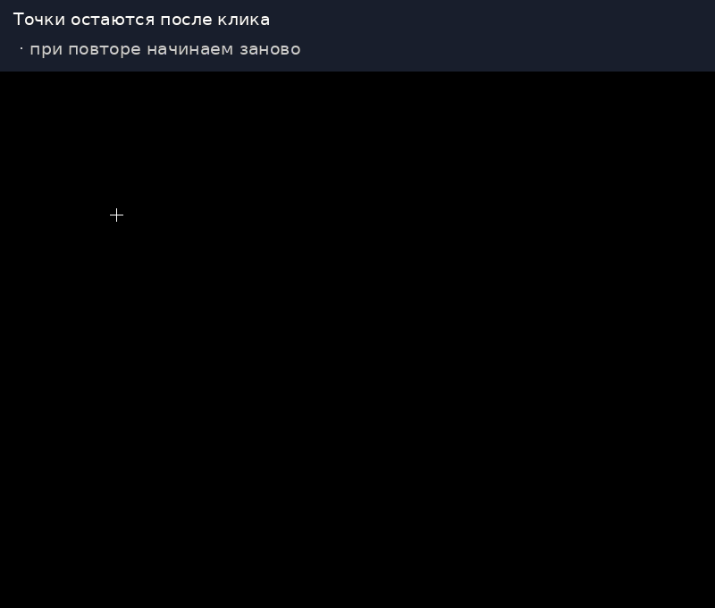

Белый указатель и плашка поясняют действия. При повторе начинаем заново.

### Что нужно сделать


1. В классе Point храни x и y; метод render(surface) рисует белый круг радиусом 5.
2. Начни с пустого списка points и черного фона.
3. Одно нажатие левой, средней или правой кнопки создает один новый Point в event.pos. Колесико игнорируй.
4. Все точки неподвижны, остаются видны одновременно и перерисовываются каждый кадр.
5. Удержание кнопки без новых нажатий не создает дополнительные точки.

### Проверь себя

Сделай три клика в разных местах. Перемести мышь и удерживай кнопку: старые точки сохраняются, новая появляется только в момент нажатия. В списке лежат объекты Point, а не пары координат.

### Подсказка

В обработчике клика создавай Point(mx, my) и добавляй его в points. Список создается до while. Проверка event.button in (1, 2, 3) исключает колесико.

> **Где выполнять**
> Создай отдельную папку для задания и файл main.py. Запускай игру на своем компьютере с Pygame. Проверь результат по пунктам выше.

Основа задания: [v1.0.0](https://docs.google.com/document/d/1pcrGPkFxnXUhhU1ntigpOSjxiuipmxOlmZNgVRrl7Vc/edit).

### Собственные атрибуты и случайный цвет

У каждой точки может быть свой цвет. Класс из демонстрации уже сохраняет его в self.color. Осталось выбирать цвет случайно при клике.

Этот кусочек работает после определения Point с параметрами x, y, color:

```python
from random import randint

color = (randint(0, 255), randint(0, 255), randint(0, 255))
point = Point(100, 200, color)
```

Три числа — красная, зеленая и синяя части цвета. Выбирай их **один раз при создании точки**. В render используй сохраненный self.color. Если выбирать цвет в render, точка будет мигать каждый кадр.

Для еще одной отдельной точки нужен еще один вызов Point(...). Запись other = point новую точку не создает: это просто второе имя той же самой точки.

**Проверь себя:** если поменять цвет одной точки, должны ли поменяться остальные? Нет, у каждой свое сохраненное значение.

### Задание 2. Множество разноцветных точек

Расширь предыдущую программу: у каждой точки теперь свой постоянный цвет.

### Что должно получиться

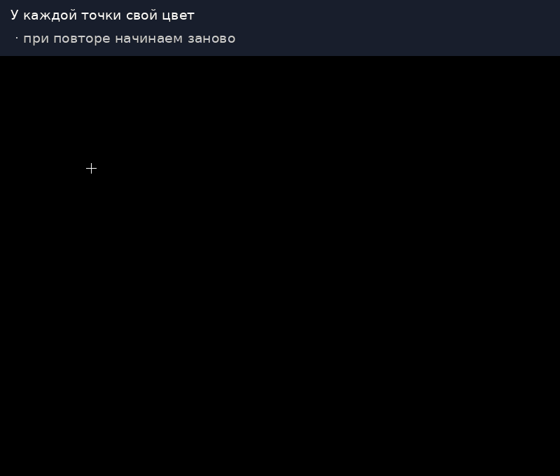

Белый указатель и плашка поясняют действия. При повторе начинаем заново.

### Что нужно сделать


1. Point хранит x, y и color. Передавай цвет в __init__.
2. RGB-компоненты выбирай независимо от 0 до 255 при каждом новом клике.
3. Сохрани размер, правила клика и перерисовку из задания 1.
4. Уже созданные точки не меняют цвет при новых кликах.

### Проверь себя

Создай не меньше десяти точек. Подожди и добавь еще одну: ни цвет, ни координаты старых точек не должны измениться.

[Посмотреть видео с примером](https://kinescope.io/at8u1C8BQhQBFt51h3iSqi). В своей программе используй размеры и правила из задания.

### Подсказка

Можно создавать color в обработчике клика и передавать его в Point. В render читай self.color.

> **Где выполнять**
> Создай отдельную папку для задания и файл main.py. Запускай игру на своем компьютере с Pygame. Проверь результат по пунктам выше.

Основа задания: [v1.0.1](https://docs.google.com/document/d/1Zh7tOzCSO9AbZl02yns1xwoc4WOwsb1MHicd6liu0S0/edit).

## Жизненный цикл объекта: круговые волны

Разделяем обновление и рисование, возвращаем результат из метода, удаляем завершенные эффекты.

### update изменяет, render показывает

Представь круги на воде после упавшего камешка. Центр стоит на месте, а радиус растет. Такую волну тоже можно сделать объектом.

Дадим ей три действия: update увеличит радиус, render нарисует круг, is_alive проверит, не пора ли его убрать. Ниже класс для файла с import pygame.

```python
class Wave:
    def __init__(self, x, y):
        self.x = x
        self.y = y
        self.radius = 2

    def update(self):
        self.radius += 2

    def is_alive(self):
        return self.radius <= 100

    def render(self, surface):
        pygame.draw.circle(surface, (100, 190, 255),
                           (self.x, self.y), self.radius, 2)
```

Сначала radius = 2. Каждый update прибавляет 2: получается 4, 6, 8 и так далее. Последняя двойка в pygame.draw.circle задает толщину контура.

return self.radius <= 100 означает: «верни ответ, не больше ли радиус 100». При 100 ответ True — волна еще нужна. При 102 ответ False — пора убрать.

Запомни разделение: update меняет числа, render рисует по этим числам. Так легче понять, где искать ошибку.

### Безопасно отбираем живые объекты

Закончившиеся волны нужно убирать. Сделаем новый список alive и положим туда только те волны, которые еще нужны. Этот кусочек ставится в игровом цикле после событий; waves создается до while.

```python
alive = []
for wave in waves:
    wave.update()
    if wave.is_alive():
        alive.append(wave)
waves = alive
```

Читаем по порядку: приготовили пустой список → увеличили волну → спросили, нужна ли она → сохранили, если ответ True. В конце заменили старый список новым.

Не удаляй элементы прямо из waves внутри for wave in waves: так легко пропустить следующую волну. С новым списком проверятся все.

Проверь себя: если сразу две волны выросли до 102, попадут ли они в alive? Нет, обе закончили расти.

### Задание 3. Круговые волны

Каждый левый клик создает расходящуюся круговую волну. Несколько волн существуют одновременно.

### Что должно получиться

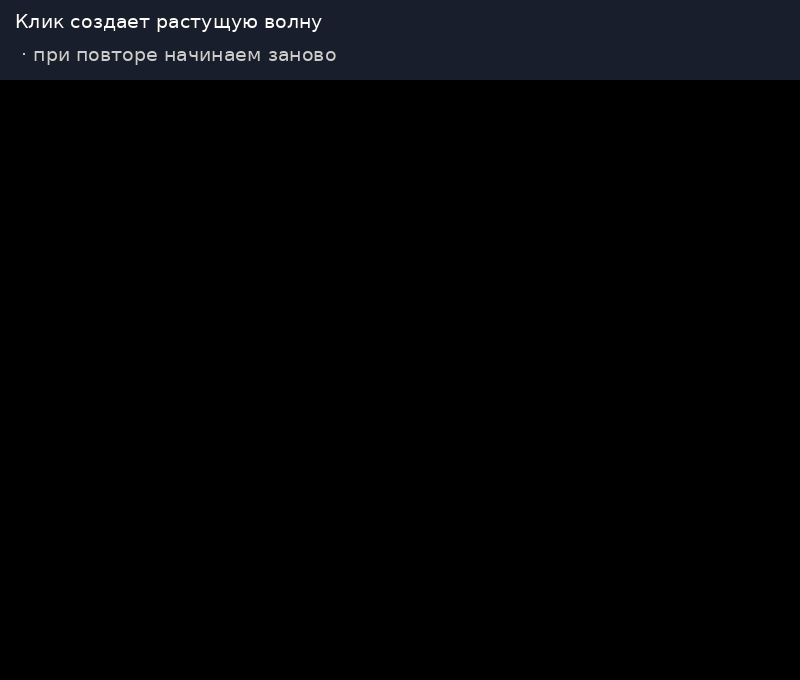

Белый указатель и плашка поясняют действия. При повторе начинаем заново.

### Что нужно сделать


1. Используй Wave с x, y, radius и методами update, is_alive, render.
2. Радиус начинается с 2, растет на 2 за кадр. Контур голубой, толщиной 2.
3. Центр берется из event.pos и больше не меняется. Фон черный.
4. Волна удаляется при radius > 100. Старые волны продолжают расти после следующего клика.

### Проверь себя

Быстро кликни трижды в разных местах, затем остановись. Круги растут независимо; спустя примерно секунду после последнего клика список пуст. Две одновременно завершившиеся волны не остаются лишний кадр.

### Подсказка

Соедини обработку клика из задания 1 с классом Wave и отбором живых объектов. Не пересоздавай список waves каждый кадр.

> **Где выполнять**
> Создай отдельную папку для задания и файл main.py. Запускай игру на своем компьютере с Pygame. Проверь результат по пунктам выше.

Основа задания: [v1.1](https://docs.google.com/document/d/1LRl4_v0WhXBmNAWWiNTZDyoOCwuBI3YspUPQa_DcejU/edit).

### Разбираем ошибки перед следующим эффектом

Если что-то не получилось, проверь один пункт за другим.

- Видна только последняя волна? Нужно добавлять новую через append, а не заменять весь список.
- Волна ходит за мышью? В render бери self.x и self.y, а не текущее место курсора.
- Волна растет только при движении мыши? update нужен каждый кадр, снаружи цикла событий.
- Остаются старые круги? Очищай фон перед рисованием нового кадра.
- Волна не исчезает? Проверь скобки в wave.is_alive(). Только так мы получаем ответ метода.

Не меняй все сразу. Исправь один пункт и снова запусти программу.

## Два класса: шарики и частицы при ударе

Передаем данные между объектами, определяем стену и создаем эффект ровно один раз.

### Движение и метод, возвращающий стену

Шарик полетит до края окна. vx = 3 означает сдвиг на 3 пикселя вправо за кадр, vy = −2 — на 2 пикселя вверх.

Ball хранит эти скорости и умеет двигаться. wall отвечает, есть ли касание стены. Это класс для файла с import pygame.

```python
class Ball:
    def __init__(self, x, y, vx, vy):
        self.x = x
        self.y = y
        self.vx = vx
        self.vy = vy
        self.radius = 8

    def update(self):
        self.x += self.vx
        self.y += self.vy

    def wall(self, width, height):
        if self.y - self.radius <= 0:
            return "top"
        if self.x - self.radius <= 0:
            return "left"
        if self.x + self.radius >= width:
            return "right"
        if self.y + self.radius >= height:
            return "bottom"
        return None

    def render(self, surface):
        pygame.draw.circle(surface, (180, 180, 180),
                           (round(self.x), round(self.y)), self.radius)
```

В update два действия: прибавить vx к x и vy к y. У шара x/y — центр. Его правая точка — x + radius, верхняя — y − radius. По ним проверяем края.

Если стены нет, wall вернет None — «ничего не найдено». Иначе вернет имя: top — верх, left — лево, right — право, bottom — низ. В углу выбираем первую подходящую стену в таком порядке. Так будет только один удар.

### Кто создает частицы и кто хранит списки

После удара шарик исчезает, а на его месте появляются семь частиц. Для этого храним два списка: balls и particles.

Каждый кадр:

1. Передвинь шарик через update.
2. Спроси wall(800, 600), есть ли удар.
3. Удара нет — оставь шарик в списке живых.
4. Удар есть — создай семь Particle и не сохраняй шарик.

У Particle тоже свои x, y, vx и vy. Добавь life = 45. Каждый кадр уменьшай life на 1; при нуле частицу убирай.

Частицы появляются у стены. Например, сверху их y = 0, справа x = 799. Вторую координату возьми у шарика и ограничь окном. Так облачко не окажется за экраном, если шарик чуть вылетел.

### Задание 4. Bullets & Sparks

Левый клик создает серый шарик. При первом касании стены он исчезает и оставляет семь частиц.

### Что должно получиться

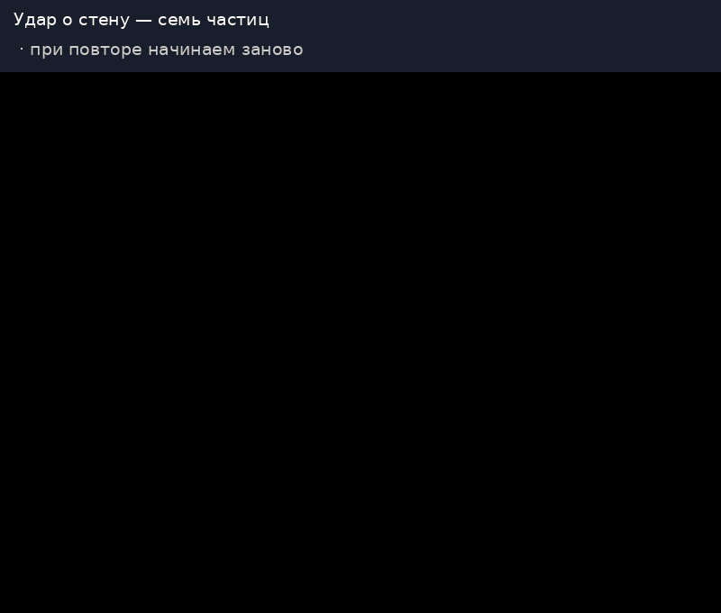

Белый указатель и плашка поясняют действия. При повторе начинаем заново.

### Что нужно сделать


1. Ball имеет радиус 8. vx и vy — случайные целые от −4 до 4, но не оба нулевые.
2. Particle хранит свои координаты и скорость, имеет радиус 3 и желтый цвет.
3. Один удар создает ровно 7 частиц в точке стены; в углу используй приоритет top, left, right, bottom.
4. Скорости частиц — от −3 до 3 по каждой оси. Частица живет 45 кадров, затем удаляется.
5. Шарик после удара удаляется; он не должен порождать новые частицы в следующих кадрах. Фон черный.

### Проверь себя

Создай шарики у каждой стены и в углу. Каждый исчезает после первого касания, облако появляется один раз. Подожди без кликов: через некоторое время оба списка пусты.

### Подсказка

Выбирай скорости при создании. Если обе равны нулю, замени vy на −1. Для каждой частицы делай новый вызов Particle(...); семь ссылок на один объект не дадут семь независимых частиц.

> **Где выполнять**
> Создай отдельную папку для задания и файл main.py. Запускай игру на своем компьютере с Pygame. Проверь результат по пунктам выше.

Основа задания: [v1.2](https://docs.google.com/document/d/1udO1rJiNiS-WMYe9jIZqNs3juhVQZ2ACcgD8C2k8kDs/edit).

### Разный результат одного события

Пусть у каждой стены будет свой эффект.

| Стена | Что появляется |
| --- | --- |
| Верх — top | Разноцветные квадраты со стороной 1–10 |
| Лево — left | Красные круги с радиусом 1–8 |
| Право — right | Синие круги с радиусом 1–8 |
| Низ — bottom | Разноцветные круги с радиусом 1–8 |

В Particle добавь shape — вид фигуры, size — размер, color — цвет. Выбирай их по имени стены при создании. В render посмотри на shape и вызови pygame.draw.circle или pygame.draw.rect.

Для круга size — радиус, для квадрата — вся сторона. Если x/y — центр квадрата, его левый верхний угол будет (x - size // 2, y - size // 2).

Размер и цвет сохраняй один раз. Тогда частица не будет мигать на лету.

### Задание 5. Bullets & Different Sparks

Расширь предыдущий эффект: у каждой стены свой вид частиц.

### Что должно получиться

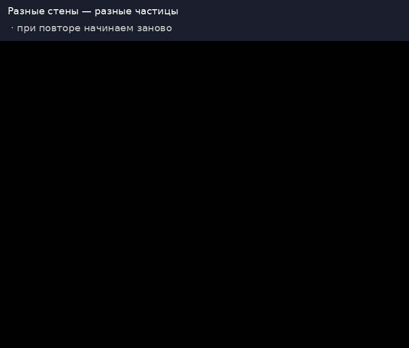

Белый указатель и плашка поясняют действия. При повторе начинаем заново.

### Что нужно сделать


1. Сохрани Ball, семь частиц на удар, скорости и время жизни из задания 4.
2. Примени таблицу форм, цветов и размеров из предыдущего степа.
3. Квадраты хранят длину стороны, круги — радиус. Не подставляй радиус как полную ширину квадрата.
4. При угловом ударе действует прежний приоритет стен; два облака не создаются.

### Проверь себя

Проверь все четыре стены. Слева нет синих частиц, справа нет красных; сверху появляются квадраты разного размера, снизу — разноцветные круги.

### Подсказка

Перед циклом создания частиц выбери shape и правило цвета по wall. Случайный размер и случайный цвет выбирай отдельно для каждой из семи частиц.

> **Где выполнять**
> Создай отдельную папку для задания и файл main.py. Запускай игру на своем компьютере с Pygame. Проверь результат по пунктам выше.

Основа задания: [v1.2.1](https://docs.google.com/document/d/1QrCx-yNVOI4tTUpL-Ii8wkv3BCUusbjnY3FYSEk206I/edit).

## Искры: направление, прозрачность и затухание

Получаем скорость из угла и рисуем alpha через отдельную поверхность.

### Случайный угол и постоянная скорость

Представь стрелку, показывающую направление полета. Ее можно повернуть. В программе такой поворот задается углом.

Вот готовый способ получить скорости по x и y из угла. Пока не нужно выводить формулу самому — попробуй разные angle.

```python
from random import uniform
from math import sin, cos, pi

angle = uniform(0, 2 * pi)
speed = 3
vx = cos(angle) * speed
vy = sin(angle) * speed
```

uniform выбирает случайное дробное число. Полный поворот обозначается 2 * pi. При angle = 0 искра летит вправо, при pi / 2 — вниз, при pi — влево. На экране y растет вниз.

cos и sin раскладывают одну скорость на две части: по x и по y. Выбери угол один раз. Потом каждый кадр прибавляй сохраненные vx и vy к координатам.

Скорости могут быть дробными. Не округляй их сразу — округляй только место рисования через round.

### Полная программа: одна искра по пробелу

Чтобы искра исчезала постепенно, добавим alpha — насколько хорошо ее видно. 255 — непрозрачная, 128 — полупрозрачная, 0 — невидимая.

Пробел создаст одну искру в центре. Найди знакомые __init__, update и render в полной программе:

```python
import pygame
from random import uniform, randint
from math import cos, sin, pi

class Spark:
    def __init__(self, x, y):
        self.x = x
        self.y = y
        angle = uniform(0, 2 * pi)
        speed = uniform(1, 4)
        self.vx = cos(angle) * speed
        self.vy = sin(angle) * speed
        self.radius = randint(2, 5)
        self.alpha = 255

    def update(self):
        self.x += self.vx
        self.y += self.vy
        self.alpha = max(0, self.alpha - 5)

    def is_alive(self):
        return self.alpha > 0

    def render(self, surface):
        size = self.radius * 2 + 2
        image = pygame.Surface((size, size), pygame.SRCALPHA)
        pygame.draw.circle(image, (255, 190, 70, self.alpha),
                           (self.radius + 1, self.radius + 1), self.radius)
        surface.blit(image, (round(self.x) - self.radius - 1,
                             round(self.y) - self.radius - 1))
pygame.init()
screen = pygame.display.set_mode((800, 600))
clock = pygame.time.Clock()
sparks = []
running = True
while running:
    for event in pygame.event.get():
        if event.type == pygame.QUIT:
            running = False
        elif event.type == pygame.KEYDOWN and event.key == pygame.K_SPACE:
            sparks.append(Spark(400, 300))
    if not running:
        break
    alive = []
    for spark in sparks:
        spark.update()
        if spark.is_alive():
            alive.append(spark)
    sparks = alive
    screen.fill((20, 24, 32))
    for spark in sparks:
        spark.render(screen)
    pygame.display.flip()
    clock.tick(60)
pygame.quit()
```

В update alpha уменьшается на 5. max(0, ...) не дает числу уйти ниже нуля. is_alive отвечает True, пока alpha больше нуля.

В render мы создаем маленький прозрачный «листочек» через Surface(..., pygame.SRCALPHA). Рисуем на нем круг с alpha, а потом накладываем листочек на экран через blit. Так фон просвечивает через искру.

Просто четвертого числа в цвете для обычного экрана недостаточно, поэтому здесь нужен этот листочек.

Попробуй заменить уменьшение на 2: искра будет гаснуть медленнее. Затем верни 5 для задания.

### Задание 6. Искры из-под курсора

Создай непрерывный поток искр при удержании левой кнопки мыши.

### Что должно получиться

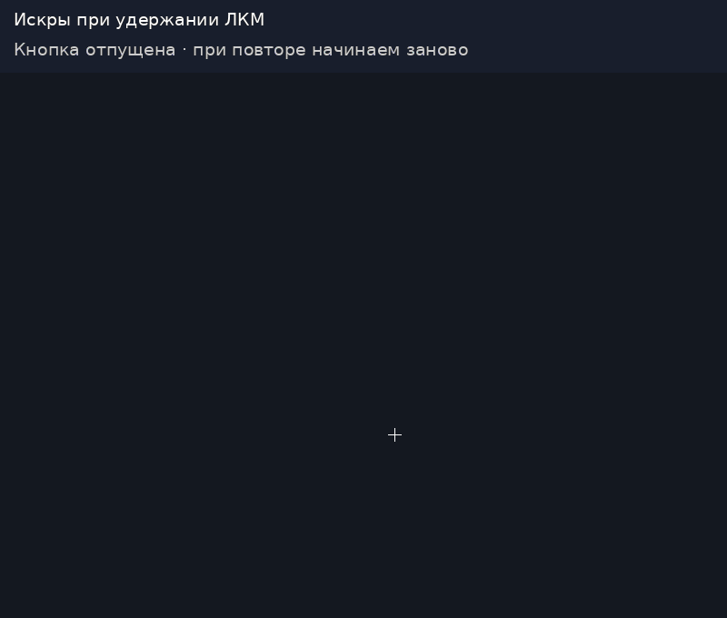

Белый указатель и плашка поясняют действия. При повторе начинаем заново.

### Что нужно сделать


1. Используй Spark с x, y, vx, vy, radius, alpha, update, is_alive и render.
2. Пока ЛКМ удерживается и курсор внутри окна, создавай по 3 новые искры за кадр в текущей позиции курсора.
3. Угол — от 0 до 2π, скорость — от 1 до 4, радиус — целое от 2 до 5. Alpha начинается с 255 и уменьшается на 5 за кадр.
4. После отпускания новые искры не появляются, старые долетают и затухают. Полностью прозрачные удаляются.
5. Фон `(20, 24, 32)` очищается каждый кадр. Положение мыши не переносит старые частицы.

### Проверь себя

Зажми кнопку, проведи мышью линию и отпусти. Поток прекращается сразу; меньше чем через секунду исчезают последние искры. На контрастном фоне видна именно прозрачность.

### Подсказка

Проверяй pygame.mouse.get_pressed()[0] после обработки событий. Координаты get_pos нужны только для новых Spark. Обновление и рисование всего списка выполняются независимо от кнопки.

> **Где выполнять**
> Создай отдельную папку для задания и файл main.py. Запускай игру на своем компьютере с Pygame. Проверь результат по пунктам выше.

Основа задания: [v1.3 (sparks)](https://docs.google.com/document/d/1s826aCreNZ6X9zwbcTSCahBC2sF0Vs4tHKBfscKKCb8/edit).

### Повторение: данные и поведение частицы

Давай разберемся, что искра помнит о себе. x/y — где она сейчас. vx/vy — куда и как быстро летит. radius — размер. alpha — насколько хорошо она видна.

__init__ задает эти значения при рождении. update двигает искру и гасит ее. render показывает ее на экране. Основной цикл хранит список и убирает погасшие искры.

Опыт: на время убери update у одной искры. Она перестанет двигаться и гаснуть, но render сможет ее нарисовать. После проверки верни вызов.

Если после долгого удержания игра замедляется, проверь удаление погасших искр.

## Составные эффекты: залп и след пули

Объединяем несколько жизненных циклов и выбираем момент рождения частиц.

### Залп: несколько объектов из одной точки

Один клик может выпустить сразу восемь снарядов. Не нужно писать восемь одинаковых строк — подойдет цикл.

Этот кусочек ставится в обработку левого клика. Bullet опиши заранее, а bullets создай до while.

```python
mx, my = event.pos
for _ in range(8):
    bullets.append(Bullet(mx, my))
```

range(8) повторяет действие восемь раз. Знак _ — имя переменной, значение которой нам не нужно. Каждый Bullet(...) делает новый снаряд.

Если каждый снаряд выберет свой случайный угол в __init__, они разлетятся по-разному. У стены вместо снаряда создадим знакомые Spark.

Порядок кадра: передвинуть снаряды → проверить удары → обновить искры → очистить фон → нарисовать все живые объекты.

### Задание 7. Залп и искры у стен

Собери составной эффект из предыдущих классов. Это задание повышенной сложности.

### Что должно получиться

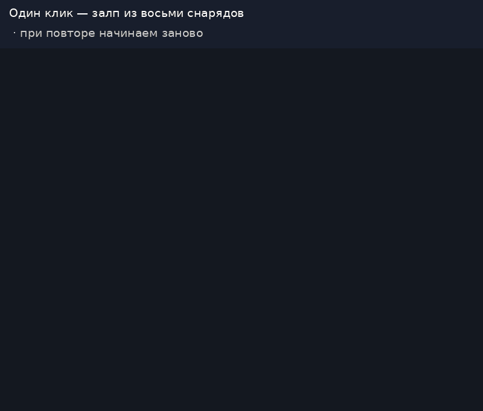

Белый указатель и плашка поясняют действия. При повторе начинаем заново.

### Что нужно сделать


1. Левый клик выпускает 8 снарядов из event.pos. У каждого радиус 5, случайный угол, скорость 5.
2. При первом касании любого края снаряд удаляется и создает 12 Spark в точке удара на границе окна.
3. Используй прозрачность, размеры, скорость и затухание искр из задания 6.
4. В углу одно облако на снаряд. Несколько залпов могут существовать одновременно.
5. После прекращения кликов все объекты со временем исчезают; неподвижные снаряды не допускаются.

### Проверь себя

Кликни один раз, дождись ударов, затем сделай три быстрых клика. Новые залпы не удаляют предыдущие. После окончания эффектов в списках нет объектов.

### Подсказка

У Bullet можно использовать движение и wall из Ball, изменив радиус и выбор скорости. Угол со скоростью 5 гарантирует ненулевой вектор. Сначала добейся работы одного снаряда и лишь затем добавь цикл из восьми.

> **Где выполнять**
> Создай отдельную папку для задания и файл main.py. Запускай игру на своем компьютере с Pygame. Проверь результат по пунктам выше.

Основа задания: [v1.4 Sparks](https://docs.google.com/document/d/1a1op8MXhYivN5Il6QA_upHXpCpK4sNdEiTWSEHmgb_I/edit).

### След — новые частицы из старого положения

Представь самолет с дымным следом. Самолет летит вперед, а дым остается там, где самолет был раньше. Сделаем то же с пулей.

Перед движением запомни old_x = bullet.x и old_y = bullet.y. Потом вызови update. Если пуля еще не коснулась стены, создай две частицы в сохраненном месте.

У каждой Particle должны быть свои x/y. Не рисуй весь след по нынешнему месту пули — иначе он поедет вместе с ней.

Для следа подойдет Spark со скоростью 0,2–1 и радиусом 1–3. Фон очищай: след состоит из отдельных частиц, а не из старых рисунков на экране.

### Задание 8. Пуля со следом

Одна пуля летит из точки клика и оставляет постепенно гаснущий след.

### Что должно получиться

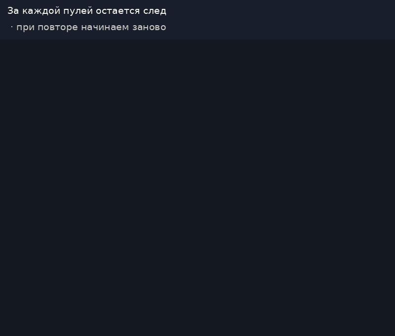

Белый указатель и плашка поясняют действия. При повторе начинаем заново.

### Что нужно сделать


1. Левый клик создает Bullet радиусом 5 со случайным направлением и скоростью 4.
2. Перед каждым шагом пули сохрани ее позицию. Если после шага пуля еще не коснулась стены, создай в старой позиции 2 частицы.
3. Particle имеет собственный случайный угол, скорость 0,2–1, радиус 1–3 и alpha 255, убывающую на 5 за кадр.
4. При касании стены пуля удаляется; ее уже созданный след продолжает жить.
5. Несколько пуль и их следы работают независимо. Фон очищается каждый кадр.

### Проверь себя

Создай две пули далеко друг от друга. Следы не прыгают к последней пуле, не обрываются целиком в момент ее исчезновения и полностью гаснут без новых кликов.

### Подсказка

Источник частиц — предыдущие координаты каждой пули. Удаление пули не должно очищать общий список particles.

> **Где выполнять**
> Создай отдельную папку для задания и файл main.py. Запускай игру на своем компьютере с Pygame. Проверь результат по пунктам выше.

Основа задания: [v1.5](https://docs.google.com/document/d/1Xy5TY2yGGkUskM_McF-74bJvNSexaZkaPqNIea2GHX8/edit).

## Пушка: управление и создание снаряда

Разделяем непрерывное движение, событие выстрела и координаты точки запуска.

### Cannon отвечает за собственное положение

Cannon означает «пушка». У нее есть место, ширина, высота и скорость. Стрелки меняют только x.

muzzle отвечает: «Где сейчас дуло?» Он возвращает два числа — место появления снаряда. Классу нужен import pygame.

```python
class Cannon:
    def __init__(self):
        self.x = 380
        self.y = 550
        self.width = 40
        self.height = 30
        self.speed = 5

    def update(self, keys):
        if keys[pygame.K_LEFT]:
            self.x -= self.speed
        if keys[pygame.K_RIGHT]:
            self.x += self.speed
        self.x = max(0, min(self.x, 800 - self.width))

    def muzzle(self):
        return self.x + self.width // 2, self.y

    def render(self, surface):
        pygame.draw.rect(surface, (90, 190, 130),
                         (self.x, self.y, self.width, self.height))
```

В update проверяются стрелки. Последняя строка оставляет x от 0 до 800 − width: пушка не уедет за край.

В игровом цикле получи keys = pygame.key.get_pressed() и передай keys в cannon.update(keys). Делай это каждый кадр, пока удерживается стрелка.

Сначала проверь движение одной пушки. Выстрелы добавим, когда она уверенно ездит в обе стороны.

### Объекты сотрудничают через методы

При пробеле спросим у пушки место выстрела и создадим там Bullet.

Для движения держим стрелку. Для выстрела ловим одно событие KEYDOWN. Не включай повтор через set_repeat: тогда один нажим даст один выстрел.

Порядок: x, y = cannon.muzzle() → создать Bullet → добавить в bullets. Если радиус снаряда 5, центр по y поставь на y − 5: круг появится над пушкой.

После создания Bullet хранит свои координаты. Пушка может уехать, но уже выпущенный снаряд не должен уехать вместе с ней.

Основной цикл связывает отдельные вещи: пушка сообщает место запуска, снаряд летит, частицы появляются у потолка.

### Задание 9. Cannon & Sparks

Сделай управляемую пушку с выстрелами вверх и вспышками у потолка.

### Что должно получиться

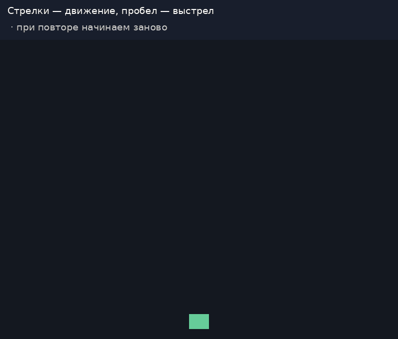

Белый указатель и плашка поясняют действия. При повторе начинаем заново.

### Что нужно сделать


1. Пушка: прямоугольник 40 × 30, начальная позиция (380, 550), скорость 5. Стрелки влево/вправо двигают ее в пределах окна.
2. Одно KEYDOWN пробела создает один Bullet из середины верхнего края пушки. Центр снаряда по y — на радиус выше дула.
3. Bullet: радиус 5, vx = 0, vy = −6. Касание потолка удаляет его и создает 10 частиц.
4. Particle: собственные координаты, vx от −3 до 3, vy от 1 до 4, радиус 2–4, случайный цвет, жизнь 45 кадров.
5. Удержание стрелки двигает пушку постоянно. Выпущенные снаряды не следуют за пушкой.

### Проверь себя

Стреляй во время движения и у обоих краев. Снаряды летят вертикально из прежних мест выстрела, пушка не выходит за экран. Вспышки появляются у верхней границы и исчезают.

### Подсказка

Для клавиатуры используй два разных механизма: get_pressed для движения, KEYDOWN для выстрела. Основной цикл создает Particle после обнаружения удара Bullet.

> **Где выполнять**
> Создай отдельную папку для задания и файл main.py. Запускай игру на своем компьютере с Pygame. Проверь результат по пунктам выше.

Основа задания: [v1.6](https://docs.google.com/document/d/1p1cDmJilFnoUJ-WaKH90ofRYrrEXtxW629SGnv--4WA/edit).

### Промежуточный итог ООП

Класс помогает описать понятную вещь: точку, волну, искру, пушку.

Данные отвечают: **«Какая она сейчас?»** Где стоит, какого размера и цвета. Методы отвечают: **«Что она умеет?»** Двигаться, рисоваться, сообщать место выстрела.

Проверь себя:

- Почему у двух пуль разные координаты, хотя класс один?
- Что означает self.x?
- Почему список пуль создается до while?
- Почему движение связано с удержанием, а выстрел — с нажатием?

Если сложно, вернись к двум точкам. Там те же идеи без управления и частиц.

## Наследование и полиморфизм на частицах

Выносим общее движение, переопределяем рисование и выбираем между наследованием и настройками.

### Базовый класс и переопределение метода

Круглая и квадратная частицы выглядят по-разному, но двигаются одинаково. Возьмем готовое движение у одного класса для другого. Это называют наследованием.

Particle — круглая частица. SquareParticle берет ее движение, но рисует квадрат. Определения работают с import pygame.

```python
class Particle:
    def __init__(self, x, y, vx, vy):
        self.x = x
        self.y = y
        self.vx = vx
        self.vy = vy

    def update(self):
        self.x += self.vx
        self.y += self.vy

    def render(self, surface):
        pygame.draw.circle(surface, (255, 100, 70),
                           (round(self.x), round(self.y)), 4)

class SquareParticle(Particle):
    def __init__(self, x, y, vx, vy, size):
        super().__init__(x, y, vx, vy)
        self.size = size

    def render(self, surface):
        pygame.draw.rect(surface, (90, 180, 255),
                         (round(self.x) - self.size // 2,
                          round(self.y) - self.size // 2,
                          self.size, self.size))
```

В class SquareParticle(Particle) скобки показывают, у какого класса берем готовые действия. Своего update здесь нет — работает update из Particle.

super().__init__(...) просит готовый класс сохранить координаты и скорости. Потом добавляем self.size.

А render написан заново и рисует квадрат. Замену готового метода своим называют переопределением. Смысл простой: движение взяли готовое, рисунок изменили.

### Один цикл для разных типов

Положим круг и квадрат в один список. Каждого попросим передвинуться и нарисоваться одинаковыми командами. Классы и screen должны быть готовы заранее.

```python
# До игрового цикла:
particles = [Particle(100, 200, 1, 0),
             SquareParticle(300, 200, -1, 0, 10)]

# Внутри игрового цикла:
for particle in particles:
    particle.update()
    particle.render(screen)
```

Команда одна — render(screen), но круглая частица рисует круг, а квадратная — квадрат. Это называют полиморфизмом: просим сделать одно и то же, каждый делает по-своему.

Наследование полезно, когда новый объект — разновидность старого. Квадратная частица остается частицей. А снаряд не является разновидностью пушки, поэтому наследование между ними не нужно.

### Мини-практика: третий вид частицы

Сделай TriangleParticle на основе Particle. Движение возьми готовое, а render пусть рисует треугольник.

Для рисунка пригодится pygame.draw.polygon(surface, color, points). points — три вершины. Для центра x/y: [(x, y - 6), (x - 6, y + 5), (x + 6, y + 5)].

Добавь треугольник к кругу и квадрату в общий список. В основном цикле оставь update и render без проверки вида фигуры.

Поменяй скорость только треугольника — другие не должны измениться. Добавь удаление фигур, полностью вышедших за окно.

### Что ты теперь умеешь

Четыре идеи на знакомых примерах:

- **Класс и объект:** описали Point, создали несколько отдельных точек.
- **Данные и действия рядом:** волна хранит радиус и сама умеет его увеличивать. Это помогает не путаться — часть идеи инкапсуляции.
- **Наследование:** квадратная частица берет готовое движение у Particle.
- **Полиморфизм:** одна команда render дает разные рисунки у круга и квадрата.

Не нужно заучивать определения. Важнее показать эти места в своем коде. Дальше добавим столкновения, предметы и здоровье.

# ООП: столкновения и взаимодействие

Делаем маленькие игры: собираем монетки, ставим платформы, зажигаем факелы и переносим предметы.

## Хитбоксы: игрок и монетка

Возвращаем pygame.Rect из метода, проверяем пересечение и переносим монетку.

### Что такое хитбокс

Как игре понять, что игрок коснулся монетки? Окружим их невидимыми прямоугольниками и проверим пересечение. Такой прямоугольник называют хитбоксом — областью для проверки касания.

pygame.Rect(x, y, width, height) создает прямоугольник. x/y — левый верхний угол, width/height — ширина и высота.

Запусти программу: квадрат следует за мышью и краснеет, когда пересекает большую рамку.

```python
import pygame

pygame.init()
screen = pygame.display.set_mode((800, 600))
clock = pygame.time.Clock()
fixed = pygame.Rect(300, 230, 180, 100)
running = True
while running:
    for event in pygame.event.get():
        if event.type == pygame.QUIT:
            running = False
    if not running:
        break
    mx, my = pygame.mouse.get_pos()
    moving = pygame.Rect(mx, my, 40, 40)
    color = (255, 100, 80) if moving.colliderect(fixed) else (100, 210, 130)
    screen.fill((20, 24, 32))
    pygame.draw.rect(screen, (130, 140, 170), fixed, 2)
    pygame.draw.rect(screen, color, moving)
    pygame.display.flip()
    clock.tick(60)
pygame.quit()
```

moving.colliderect(fixed) отвечает True при пересечении прямоугольников. Если они просто стоят вплотную границами, ответ False.

Монетку нарисуем круглой, но для простой проверки дадим ей квадратный хитбокс. У его угла сбор может сработать чуть раньше видимого касания круга. Пока такой проверки достаточно.

### Player и возвращаемая область

Player хранит место, размер, скорость и цвет игрока. get_hitbox возвращает прямоугольник в его текущем месте. Классу нужен import pygame.

```python
class Player:
    def __init__(self, x, y):
        self.x = x
        self.y = y
        self.size = 40
        self.speed = 4
        self.color = (100, 200, 255)

    def update(self, keys):
        if keys[pygame.K_LEFT]:
            self.x -= self.speed
        if keys[pygame.K_RIGHT]:
            self.x += self.speed
        if keys[pygame.K_UP]:
            self.y -= self.speed
        if keys[pygame.K_DOWN]:
            self.y += self.speed
        self.x = max(0, min(self.x, 800 - self.size))
        self.y = max(0, min(self.y, 600 - self.size))

    def get_hitbox(self):
        return pygame.Rect(self.x, self.y, self.size, self.size)

    def render(self, surface):
        pygame.draw.rect(surface, self.color, self.get_hitbox())
```

У Player x/y — левый верхний угол. update двигает игрока по стрелкам и оставляет в окне. Сначала двигай, потом проверяй столкновение: get_hitbox покажет новое место.

У Coin x/y будут центром. Его хитбокс начинается в x − radius, y − radius и имеет ширину и высоту 2 * radius.

render — название метода рисования. Используем его у игрока и монетки.

### Задание 10. Игрок и монетки

Управляй квадратом стрелками и собирай желтую монетку, которая появляется в новом месте.

### Что должно получиться

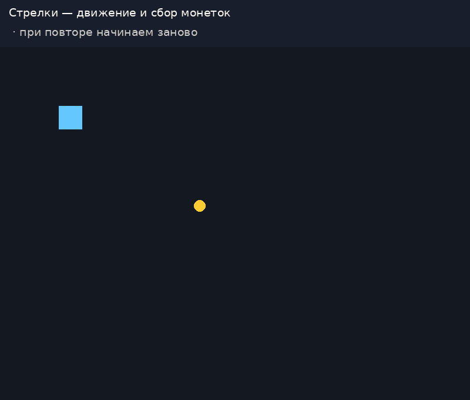

Белый указатель и плашка поясняют действия. При повторе начинаем заново.

### Что нужно сделать


1. Player: старт (100, 100), размер 40, скорость 4, голубой цвет, методы update(keys), render(surface), get_hitbox(). Не выпускай игрока за окно.
2. Coin: радиус 10, желтый цвет, случайная позиция целиком внутри окна; методы random_position(), render(surface), get_hitbox().
3. После движения проверяй пересечение хитбоксов. При сборе переноси монетку и продолжай игру.
4. Новая монетка не должна пересекать игрока. Повторяй выбор позиции, пока не найдется свободная. Проверяй сбор только один раз за кадр.
5. Фон темный. Счет добавлять необязательно.

### Проверь себя

Собери пять монеток, подходя с разных сторон. Каждая остается в окне и после сбора не лежит под игроком. Удержание стрелок работает в кадрах без новых событий.

### Подсказка

Проверка выглядит как player.get_hitbox().colliderect(coin.get_hitbox()). При переносе сначала выбери новую позицию, затем проверь, не попала ли монетка внутрь игрока.

> **Где выполнять**
> Создай отдельную папку для задания и файл main.py. Запускай игру на своем компьютере с Pygame. Проверь результат по пунктам выше.

Основа задания: [v2.0 (collisions)](https://docs.google.com/document/d/19xA2eTCv6MISQyDV2e_gVfK1cJOwWNeWhLutq7Qw6Bs/edit).

### Инкапсуляция: один источник координат

Если рисунок игрока уже справа, а хитбокс остался слева, монетки будут собираться в странных местах. Рисование и проверка должны брать одно и то же положение.

В Player это self.x и self.y. Их используют и render, и get_hitbox. Можно иначе: хранить один self.rect и рисовать его. Так сделаем с платформами.

Не делай две разные копии положения, которые легко разойдутся. И держи правила в методах: update не выпускает игрока за окно, random_position не кладет монетку за край.

Это пример инкапсуляции: правило находится рядом с данными, которые оно меняет.

## Платформы: размещение и текст на экране

Храним геометрию внутри класса и показываем число оставшихся платформ.

### Platform содержит pygame.Rect

Платформа — неподвижный прямоугольник. Сохраним его в self.rect и добавим рисование. Нужен import pygame.

```python
class Platform:
    def __init__(self, x, y):
        self.rect = pygame.Rect(x, y, 100, 12)

    def get_hitbox(self):
        return self.rect

    def render(self, surface):
        pygame.draw.rect(surface, (220, 220, 235), self.rect)
```

Rect уже хранит x, y, ширину и высоту. Отдельные копии self.x и self.y нам не нужны.

Когда объект содержит другой объект, это называют композицией. Представь рюкзак с тетрадью: он не становится тетрадью, а просто содержит ее. Так же Platform содержит Rect.

При клике создавай Platform и клади в список. Чтобы платформа 100 × 12 у края осталась целиком в окне, ограничь ее x до 700, y до 588.

### Текст — еще одна поверхность

Покажем «Осталось платформ: 5». Сначала после pygame.init(), до while, создай шрифт. Потом каждый кадр делай картинку с надписью.

```python
# Один раз, до while:
font = pygame.font.SysFont("dejavusans", 24)

# Внутри while, после очистки фона:
remaining = 5 - len(platforms)
label = font.render(f"Осталось платформ: {remaining}", True, (255, 255, 255))
screen.blit(label, (15, 15))
```

len(platforms) — сколько платформ уже стоит. Значит, 5 − len(platforms) — сколько еще можно поставить.

font.render делает картинку с текстом. True просит сгладить буквы, тройка 255 задает белый цвет. blit помещает картинку в (15, 15).

Рисуй надпись после платформ, чтобы она была сверху. Если русские буквы заменены квадратами, выбери шрифт с кириллицей. Можно положить font.ttf рядом с программой и загрузить pygame.font.Font("font.ttf", 24).

### Задание 11. Расстановка пяти платформ

Создай первый этап будущей игры: размести ограниченное количество платформ.

### Что должно получиться

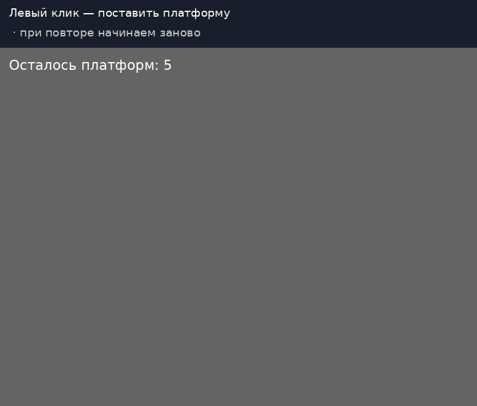

Белый указатель и плашка поясняют действия. При повторе начинаем заново.

### Что нужно сделать


1. Окно с серым фоном `(100, 100, 100)`, список platforms изначально пуст.
2. Один левый клик создает одну Platform размером 100 × 12. event.pos задает левый верхний угол с ограничением по краям окна.
3. Разрешено не более пяти платформ. Перекрытие платформ пока допустимо.
4. Слева сверху постоянно видна надпись «Осталось платформ: N»; сначала N = 5, затем уменьшается до 0.
5. После пятой платформы дальнейшие клики ничего не добавляют. Удержание кнопки не создает копии.

### Проверь себя

Сделай семь кликов, включая правый нижний угол. На экране ровно пять целых платформ, счетчик 0. Старые платформы не меняют положение.

### Подсказка

Проверку лимита делай внутри обработки каждого клика: несколько событий могут прийти в одном кадре. Не используй отдельный счетчик, если его можно вычислить через len.

> **Где выполнять**
> Создай отдельную папку для задания и файл main.py. Запускай игру на своем компьютере с Pygame. Проверь результат по пунктам выше.

Основа задания: [v3.0:1](https://docs.google.com/document/d/1pWMAiZlIV0nBdJE0UMEgVeMl0Oadc-6GnyHc7s_UoQE/edit).

### Подготовка ко второму этапу

Сохрани эту программу — дальше добавим мяч.

Проверь три вещи: platforms создается до while; новая платформа появляется по клику; рисование проходит по готовому списку.

Почему лимит проверяется для каждого клика? За один кадр могут прийти несколько нажатий. Каждое должно отдельно проверить, остались ли свободные платформы.

Следующим шагом появятся два этапа: сначала строим, потом играем. Выбрать этап поможет обычная переменная.

## Состояния игры и отскок мяча

Переключаем этапы и устраняем повторный отскок при пересечении платформы.

### Два этапа и состояние запуска

Представь настольную игру: сначала расставляем фишки, потом начинаем ходить. Программе тоже нужно знать текущий этап.

В начале state = "platform". Пока там это слово, клики ставят платформы. После пятой поменяй state на "ball" и создай мяч один раз.

Мяч уже виден, но стоит. В нем хранится started = False. Пробел сделает started = True, и только тогда update начнет движение.

| Этап | Что можно делать |
| --- | --- |
| Расстановка | Кликать до пяти платформ |
| Мяч ждет | Нажать пробел |
| Мяч летит | Смотреть отскоки, повторный пробел ничего не меняет |

state выбирает этап игры, started хранит запуск мяча. Это обычные значения для нужных веток if.

### Почему одного vy = -vy недостаточно

Для отскока меняем направление: vy = -vy. Но если мяч остался внутри платформы, в следующем кадре знак поменяется снова. Получится дрожание.

После удара поставим мяч рядом с платформой. Для этого запомним старое место и узнаем, с какой стороны он прилетел.

Это кусочек внутри update(self, platforms) класса Ball. self.rect — хитбокс 20 × 20, vx/vy — целые скорости.

```python
# Фрагмент метода update(self, platforms) класса мяча.
# self.rect — квадратная область мяча 20 × 20; скорости целые.
old = self.rect.copy()
self.rect.x += self.vx
self.rect.y += self.vy
for platform in platforms:
    target = platform.get_hitbox()
    if self.rect.colliderect(target):
        if self.vy > 0 and old.bottom <= target.top:
            self.rect.bottom = target.top
            self.vy = -abs(self.vy)
            break
        elif self.vy < 0 and old.top >= target.bottom:
            self.rect.top = target.bottom
            self.vy = abs(self.vy)
            break
```

old — место до шага. Если мяч падал и раньше был над платформой, ставим его низ на верх платформы и направляем вверх. Для прилета снизу делаем наоборот.

abs делает число положительным: -abs(vy) всегда направляет вверх, abs(vy) — вниз. break останавливает поиск, чтобы не получить два отскока за кадр.

Это простая учебная физика: квадратный хитбокс, небольшая скорость, отскок от верхней и нижней сторон. Боковые удары пока не делаем.

### Задание 12. Платформы и запуск мячика

Продолжи задание 11: после расстановки пяти платформ запускается второй этап.

### Что должно получиться

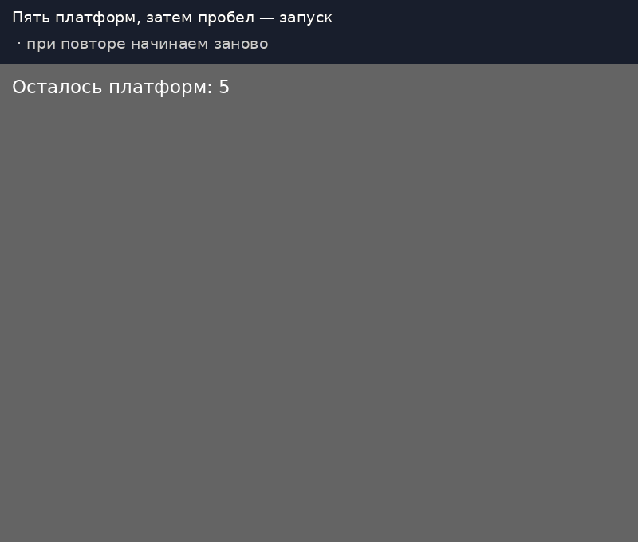

Белый указатель и плашка поясняют действия. При повторе начинаем заново.

### Что нужно сделать


1. Сохрани state со значениями platform и ball. После пятой платформы расстановка отключается.
2. Создай Ball с rect 20 × 20, начальным центром (30, 570), vx = 4, vy = −3 и started = False.
3. Пробел запускает движение вверх-вправо; повторные нажатия не создают новые мячи и не сбрасывают позицию.
4. От платформ отражай вертикальную скорость с выведением из пересечения, как в примере. От границ окна отражай соответствующую ось и возвращай rect внутрь окна.
5. Мяч и пять платформ остаются видны. Вторая надпись сообщает «Пробел — запуск» до старта, затем «Мяч запущен».
6. Для проверки размести платформы по одному клику: (100, 480), (250, 380), (400, 280), (550, 180), (650, 100). Так путь от старта свободен.

### Проверь себя

До пятого клика мяча нет. После — он виден и ждет пробела. На проверочной раскладке первый удар снизу о платформу меняет полет вверх на вниз. Мяч не дрожит на платформе, не застревает у стен; клики и повторный пробел не создают лишних объектов.

[Посмотреть видео с примером](https://kinescope.io/ak7478yoP6Z2UGj5iPJ7wQ). В своей программе используй размеры и правила из задания.

### Подсказка

В Ball.update сначала проверь started. При выходе справа задай rect.right = 800 и vx = -abs(vx); аналогично для остальных краев. Сначала обработай отскок от границ, затем платформы.

> **Где выполнять**
> Создай отдельную папку для задания и файл main.py. Запускай игру на своем компьютере с Pygame. Проверь результат по пунктам выше.

Основа задания: [v3.0:2](https://docs.google.com/document/d/1T3488QmXQprDs7Eejuj9YTQxftoYBfdQjebW_K1AIoM/edit).

### Отладка переходов

Мяч постоянно возвращается в угол? Скорее всего, он создается заново каждый кадр. Создание должно сработать только после пятого успешного клика.

Мяч дрожит? Нарисуй его хитбокс рамкой и проверь, выходит ли он из платформы после удара.

Пока используй расстановку из задания: она не перекрывает место старта. Дополнительно можно запретить ставить платформы прямо на старт.

Проверяй по очереди: появление мяча → запуск → стены → одна платформа → несколько. Так легче найти ошибку.

## Взаимодействие: зажигаем факелы

Сохраняем состояние каждого предмета и выбираем доступную цель для E.

### Личное состояние факела

У факела два состояния: выключен и горит. Сохраним это в lit. Сначала False, после зажигания True.

Вокруг сделаем невидимую область: если игрок вошел в нее, можно нажать E. Для класса нужен import pygame, у игрока должен быть get_hitbox.

```python
class Torch:
    def __init__(self, x, y):
        self.rect = pygame.Rect(x, y, 20, 60)
        self.lit = False

    def is_near(self, player):
        zone = self.rect.inflate(120, 0)
        return zone.colliderect(player.get_hitbox())

    def ignite(self):
        self.lit = True

    def render(self, surface):
        color = (255, 170, 50) if self.lit else (90, 80, 70)
        pygame.draw.rect(surface, color, self.rect)
```

ignite только ставит True, поэтому повторное зажигание не потушит огонь.

inflate(120, 0) создает область шире факела: по 60 с каждой стороны. Сам факел не меняет размер. is_near проверяет пересечение области с игроком.

Дальше Player ходит только по горизонтали: оставь y = 520, движение A/D и стрелками влево/вправо. Глаза можно нарисовать двумя маленькими светлыми прямоугольниками на теле.

### Одна цель — одно нажатие

Если рядом выключенный факел, покажи «Нажмите E». Подсказка и действие должны относиться к одному предмету.

Найди ближайший среди доступных выключенных факелов и назови его target — цель. Если никого рядом нет, target = None. Для сравнения расстояний подойдет abs(torch.rect.centerx - player.get_hitbox().centerx): меньше число — ближе факел. При равенстве оставь первый в списке.

В начале кадра interact_pressed = False. Событие KEYDOWN E меняет его на True. Потом передвинь игрока, найди target и, если E был нажат, вызови ignite у цели.

Не зажигай все факелы подряд одним нажимом: даже при пересечении областей должен меняться один ближайший предмет.

### Задание 13. Зажги все факелы

Игрок подходит к выключенным факелам и зажигает каждый отдельно.

### Что должно получиться

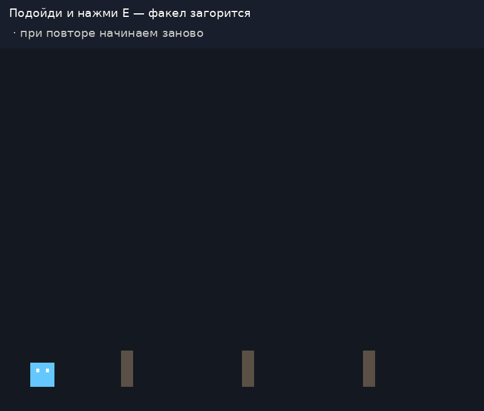

Белый указатель и плашка поясняют действия. При повторе начинаем заново.

### Что нужно сделать


1. Player — квадрат 40 × 40 с глазами, старт (50, 520), скорость 4. Управление A/D и стрелками влево/вправо, границы окна учитываются.
2. Три Torch с rect 20 × 60 в (200, 500), (400, 500), (600, 500). Изначально lit = False у каждого.
3. Для доступного ближайшего выключенного факела показывай «Нажмите E» над игроком.
4. Одно KEYDOWN E зажигает только выбранный факел. Он остается зажженным; подсказка для него больше не появляется.
5. Нажатие E вдали ничего не делает. Используй собственное состояние каждого факела.

### Проверь себя

Нажми E вдали, затем у каждого факела. Уже зажженные не гаснут. Если временно поставить два факела рядом, один нажим меняет только один доступный объект.

[Посмотреть видео с примером](https://kinescope.io/jsrjAcKSGFdMxPjc8PKKKv). В своей программе используй размеры и правила из задания.

[Картинки для игры](https://drive.google.com/drive/folders/1t9_VH5KSTkyRz0w3LryDSF5o0leMmQ_s). Можно начать с геометрических фигур и затем заменить их картинками: поведение должно остаться тем же.

### Подсказка

Тело факела можно рисовать прямоугольником, а огонь — маленьким оранжевым кругом. Начни с этой версии, затем при желании добавь картинки.

> **Где выполнять**
> Создай отдельную папку для задания и файл main.py. Запускай игру на своем компьютере с Pygame. Проверь результат по пунктам выше.

Основа задания: [v4.0 (interaction)](https://docs.google.com/document/d/1hON3xEAoo9VnuUcJP7M2f1hYLYP3WxQrnzvGJmIkX8o/edit).

### Как заменить геометрию картинками

Скачай картинки выключенного и горящего факела. Посмотри, какая из них какая, и назови torch_off.png и torch_on.png.

После создания окна загрузи один раз: image = pygame.image.load("torch_off.png").convert_alpha(). Для размера подойдет pygame.transform.scale(image, (20, 60)).

В render выбери картинку по lit и покажи через surface.blit(image, self.rect.topleft).

Правила игры прежние: rect хранит место, lit — горит ли факел. Не загружай файлы каждый кадр: это лишняя работа для компьютера.

## Здоровье игрока и ядовитый гриб

Измеряем реальное время между кадрами и наносим урон через метод игрока.

### Правило здоровья находится в Player

Добавь self.hp = 100 в Player.__init__. hp — сколько здоровья осталось. Для урона сделаем take_damage.

Эти методы нужно добавить внутри Player с тем же отступом, что update и render:

```python
# Эти методы добавь ВНУТРЬ класса Player.
# В __init__ также добавь: self.hp = 100
def take_damage(self, amount):
    self.hp = max(0, self.hp - max(0, amount))

def is_alive(self):
    return self.hp > 0
```

player.take_damage(10) уменьшит здоровье на 10. max не дает опуститься ниже нуля. Отрицательный урон здесь не увеличивает здоровье.

is_alive отвечает True, если здоровье еще есть. Гриб хранит свое место и опасную область, но здоровье хранится только в Player.

Так легко найти нужное правило: за изменение здоровья отвечает метод самого игрока.

### Секунда измеряется временем, а не 60 кадрами

Если отнимать 10 каждый кадр, здоровье закончится сразу. Нужно отнимать 10 раз в секунду.

clock.tick(60) возвращает, сколько миллисекунд прошло. 1000 миллисекунд — секунда. В начале кадра пиши elapsed_ms = clock.tick(60). Старый tick в конце убери: один вызов на кадр.

До while вызови clock.tick(60) для начала отсчета и создай damage_ms = 0. После движения игрока используй этот кусочек:

```python
# Фрагмент игрового цикла после обновления игрока.
# elapsed_ms получен в начале кадра через clock.tick(60).
# damage_ms = 0 задается ОДИН раз перед while.
if mushroom.is_near(player):
    damage_ms += elapsed_ms
    while damage_ms >= 1000:
        player.take_damage(10)
        damage_ms -= 1000
else:
    damage_ms = 0
if not player.is_alive():
    running = False
```

Рядом с грибом складываем время. Накопилась 1000 — наносим урон и вычитаем 1000. Игрок ушел — счетчик обнуляется, новый подход начнет новую секунду.

while нужен на случай долгого кадра. За 2100 мс будет два урона и остаток 100 мс.

Не используй sleep для ожидания: вместе с ним замрет управление и вся игра.

### Задание 14. Ядовитый гриб

Рядом с грибом игрок теряет здоровье, а вдали урон прекращается.

### Что должно получиться

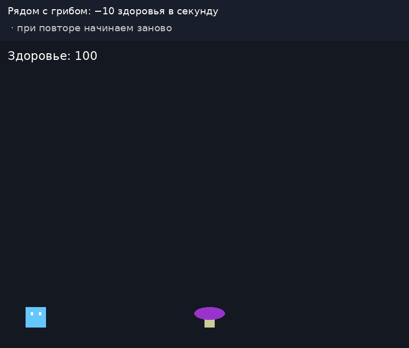

Белый указатель и плашка поясняют действия. При повторе начинаем заново.

### Что нужно сделать


1. Используй горизонтальное управление и Player из задания 13, добавив hp = 100, take_damage и is_alive.
2. Mushroom находится в (390, 520), его rect 40 × 40. Зона действия — rect.inflate(120, 0).
3. Непрерывная секунда в зоне наносит 10 урона. При выходе неполная секунда сбрасывается, здоровье не восстанавливается.
4. Слева сверху показывай «Здоровье: N», обновляя текст при изменениях.
5. При hp <= 0 выйди из игрового цикла и вызови pygame.quit(). Крестик работает и до смерти игрока.

### Проверь себя

За 900 мс рядом hp не меняется, за 1000 мс становится 90. Уйди на полсекунде и вернись: первый урон снова через полную секунду. Вдали hp постоянно, после десяти секунд непрерывного воздействия окно закрывается.

[Посмотреть видео с примером](https://kinescope.io/amaF1V3mVYrayBeA8kuZFu). В своей программе используй размеры и правила из задания.

[Картинки для игры](https://drive.google.com/drive/folders/1XZqPr5HvSDVyQVz-iKlnpZrHzWzYyFRT). Можно начать с геометрических фигур и затем заменить их картинками: поведение должно остаться тем же.

### Подсказка

Mushroom.is_near(player) только проверяет зону. Накопитель времени хранится в основном цикле. Рисовать гриб можно ножкой и шляпкой или изображением.

> **Где выполнять**
> Создай отдельную папку для задания и файл main.py. Запускай игру на своем компьютере с Pygame. Проверь результат по пунктам выше.

Основа задания: [v4.0.0](https://docs.google.com/document/d/1JcttyJZWUjnshuPnTiomS6-pLBKyR6y-JgrvfYEbMuE/edit).

### Проверяем таймер отдельно от графики

Посчитаем вручную. Сначала damage_ms = 0, игрок рядом.

Прошло 400 мс — урона нет. Еще 300 — всего 700, тоже нет. Еще 300 — всего 1000: один урон и счетчик 0.

Если прошло сразу 2500 мс, это два раза по 1000 и остаток 500. Значит, два урона и 500 в счетчике.

А если постоял 600 мс, вышел и вернулся еще на 600? Урона нет: выход сбросил первый отсчет.

Можно временно выводить damage_ms через print. Когда разберешься, убери постоянный вывод.

## Инвентарь: ключ и сундук

Используем композицию и связываем подсказки с текущим состоянием предметов.

### Игрок имеет инвентарь

Инвентарь — то, что игрок несет с собой. Пока достаточно помнить: ключ есть или ключа нет. Сделаем Inventory.

Это программа без Pygame. Explorer — простой пример владельца рюкзака:

```python
class Inventory:
    def __init__(self):
        self.has_key = False
        self.has_crystal = False

class Explorer:
    def __init__(self):
        self.inventory = Inventory()

first = Explorer()
second = Explorer()
first.inventory.has_key = True
print(first.inventory.has_key)   # True
print(second.inventory.has_key)  # False
```

В игре добавь self.inventory = Inventory() в Player.__init__. У каждого нового игрока будет свой инвентарь.

Это композиция: игрок имеет инвентарь. Он не является разновидностью инвентаря.

У ключа на земле picked_up = False. После подбора ставим True, а у player.inventory.has_key тоже True. Ключ больше не рисуем. Он многоразовый: открывание сундука его не тратит.

### Закрытый и открытый сундук

Сундук закрыт или открыт — запомним это в opened. interact переключит состояние, только если есть ключ. Запусти программу без Pygame:

```python
class Chest:
    def __init__(self):
        self.opened = False

    def interact(self, has_key):
        if has_key:
            self.opened = not self.opened

chest = Chest()
chest.interact(False)
print(chest.opened)  # False
chest.interact(True)
print(chest.opened)  # True
chest.interact(True)
print(chest.opened)  # False
```

not меняет ответ на противоположный: False становится True, True становится False. Поэтому каждое interact(True) открывает закрытый или закрывает открытый сундук.

Подсказка зависит от ситуации. Нет ключа — «Сундук заперт. Найдите ключ». Есть ключ, сундук закрыт — «Нажмите E, чтобы открыть сундук». Открыт — «Нажмите E, чтобы закрыть сундук».

Выполняй действие по KEYDOWN. От удержания не должно быть быстрого переключения туда-сюда.

### Задание 15. Ключ и сундук

Подбери ключ и с его помощью открывай и закрывай сундук.

### Что должно получиться

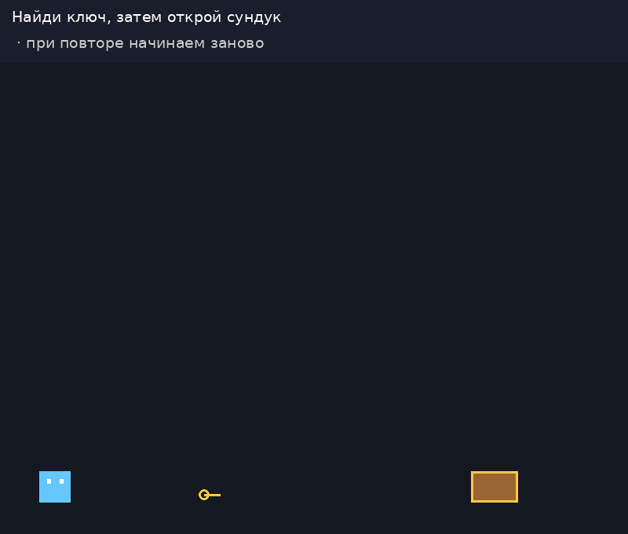

Белый указатель и плашка поясняют действия. При повторе начинаем заново.

### Что нужно сделать


1. Player с горизонтальным управлением начинает в (50, 520). В inventory.has_key изначально False.
2. Key имеет rect 20 × 20 в (250, 540), picked_up = False. Chest — rect 60 × 40 в (600, 520), opened = False.
3. Зона каждого предмета — его rect.inflate(120, 0). Вне зон подсказок нет; в пересечении зон выбери ближайшую цель.
4. Рядом с ключом показывай «Нажмите E, чтобы подобрать ключ». KEYDOWN E убирает ключ из мира и дает его игроку.
5. Без ключа сундук не открывается и показывает сообщение о замке. С ключом E открывает закрытый сундук, повторное нажатие закрывает открытый.
6. Открытое и закрытое состояния визуально различаются. Ключ не расходуется.

### Проверь себя

Сначала подойди к сундуку без ключа и нажми E. Затем подбери ключ и вернись: сундук открывается и закрывается отдельными нажатиями. Ключ не появляется снова, открытое состояние сохраняется, когда игрок отходит.

[Посмотреть видео с примером](https://kinescope.io/iedH3MA4B4NmCHWR41vUu7). В своей программе используй размеры и правила из задания.

[Картинки для игры](https://drive.google.com/drive/folders/1uRr-zbeE-M-xEFVKMDd8UtfkHi0HuWRV). Можно начать с геометрических фигур и затем заменить их картинками: поведение должно остаться тем же.

### Подсказка

У Key и Chest будут собственные rect, состояние и render. В основном цикле связывай взаимодействие с inventory игрока. Не делай picked_up общим атрибутом класса.

> **Где выполнять**
> Создай отдельную папку для задания и файл main.py. Запускай игру на своем компьютере с Pygame. Проверь результат по пунктам выше.

Основа задания: [v4.1](https://docs.google.com/document/d/1bzK7NkZnwyr5XgQul21rEqY9OlszfOgnT-QjpNxdJks/edit).

### Состояния и допустимые переходы

Проверь цепочки действий.

Ключ на земле → подобрали E → ключ в инвентаре. Обратного действия тут нет.

Сундук закрыт → нажали E с ключом → открыт. Еще одно нажатие с ключом закроет его.

Ключ появился снова? Не создавай новый Key внутри while. Сундук мигает? Проверь KEYDOWN. Открывается без ключа? Проверь условие перед переключением.

Простые True и False запоминают то, что уже произошло. Поэтому игра помнит найденный ключ, даже когда игрок отошел.

## Перенос предмета: подбери и положи кристалл

Согласуем состояние инвентаря и мира, завершаем практику по ООП.

### Один кристалл в двух состояниях

Представь мячик: либо он лежит на земле, либо ты несешь его. В двух местах сразу его быть не может.

У Crystal будет on_ground — лежит ли он на земле. У Inventory — has_crystal, несет ли его игрок.

| Ситуация | on_ground | has_crystal |
| --- | --- | --- |
| Лежит в начале | True | False |
| Подобрали E | False | True |
| Положили F | True | False |

Пока кристалл несут, его не рисуем. Когда кладут, он появляется у ног игрока и остается там после его ухода.

Меняй оба значения вместе, чтобы предмет не остался и на земле, и в инвентаре одновременно.

### Методы перехода и единые координаты

Сделаем два действия: crystal.pick_up(player) — подобрать, crystal.drop(player) — положить.

pick_up проверит, лежит ли кристалл и рядом ли игрок. Только затем он уберет предмет и отметит его в инвентаре.

drop проверит инвентарь, возьмет нынешнее место игрока и поставит туда кристалл. Отметка в инвентаре станет False.

Храни в Crystal один self.rect 20 × 20. При выкладывании его centerx ставь на player.get_hitbox().centerx, а bottom — на player.get_hitbox().bottom. Ограничь окно. Еще одна независимая копия x/y не нужна.

После выкладывания не копируй координаты игрока каждый кадр: предмет уже лежит отдельно. Для E/F используй KEYDOWN. Если оба события пришли в одном кадре, выполняй их в порядке очереди.

### Задание 16. Подбери и положи кристалл

Создай игру, в которой один кристалл можно многократно переносить по уровню.

### Что должно получиться

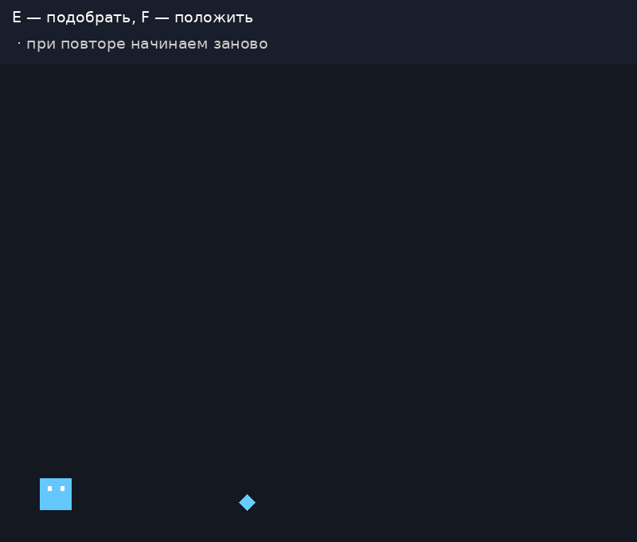

Белый указатель и плашка поясняют действия. При повторе начинаем заново.

### Что нужно сделать


1. Player с горизонтальным управлением и Inventory начинает в (50, 520). Кристалл размером 20 × 20 лежит в (300, 540).
2. У Crystal есть rect, on_ground и методы проверки близости, подбора, выкладывания и рисования. Зона — rect.inflate(120, 0).
3. Рядом с лежащим кристаллом показывай «Нажмите E». KEYDOWN E подбирает его: он исчезает с земли, has_crystal становится True.
4. KEYDOWN F при наличии кристалла кладет его у ног в текущем месте игрока. has_crystal становится False, on_ground — True.
5. Выложенный предмет остается неподвижным, когда игрок уходит. Его можно снова подобрать E.
6. E вдали и F без кристалла ничего не меняют. Рисовать инвентарь не требуется.

### Проверь себя

Подбери кристалл, пройди вправо, положи и уйди влево: предмет остается на месте. Нажми F без предмета — копия не появляется. Вернись и повтори перенос; одновременно в мире и в инвентаре кристалла быть не должно.

[Посмотреть видео с примером](https://kinescope.io/xqj71vMg9bEHrpxAsNRrez). В своей программе используй размеры и правила из задания.

[Картинки для игры](https://drive.google.com/drive/folders/1h0ZcoY4xy9QlTz1Dulv2I4X079zbQA6d). Можно начать с геометрических фигур и затем заменить их картинками: поведение должно остаться тем же.

### Подсказка

Держи изменения состояния в двух методах. После drop позиция кристалла больше не обновляется от player.x. Для E/F используй события нажатий, не постоянную проверку удержания.

> **Где выполнять**
> Создай отдельную папку для задания и файл main.py. Запускай игру на своем компьютере с Pygame. Проверь результат по пунктам выше.

Основа задания: [v4.2](https://docs.google.com/document/d/19Rn1s25dm_wt6_KeHynUKwDCYJINfAXTunGkPOHJiyI/edit).

### Итоговый разбор: как устроена небольшая игра

В начале была точка с двумя числами. Теперь есть игрок, предметы и правила игры. Идея та же: у каждой вещи свои данные и действия.

Объясни код другу. Покажи создание объекта, его данные и вызов метода. Расскажи, почему один зажженный факел не зажигает остальные и почему выложенный кристалл остается на земле.

Дополнительный проект: собери факелы, гриб, ключ, сундук и кристалл на одном уровне. Оставь один Player, один Inventory и один игровой цикл. Добавляй предметы по одному и проверяй результат.

Если можешь показать на своем примере class, объяснить self и создать два независимых объекта, главная цель этих уроков достигнута.
