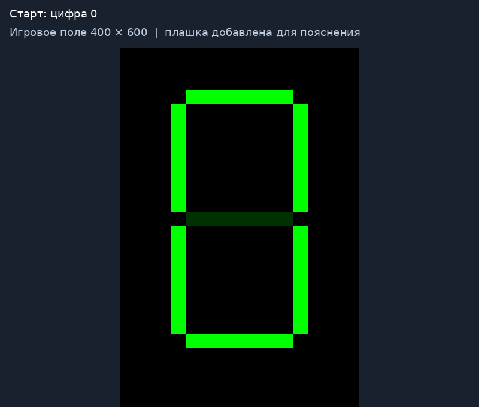
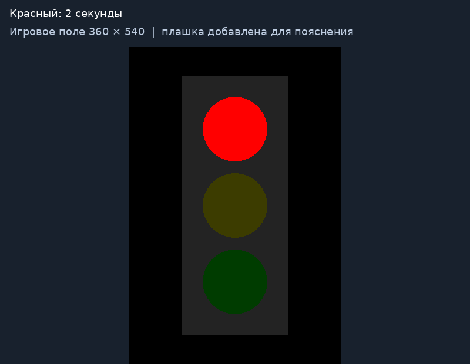
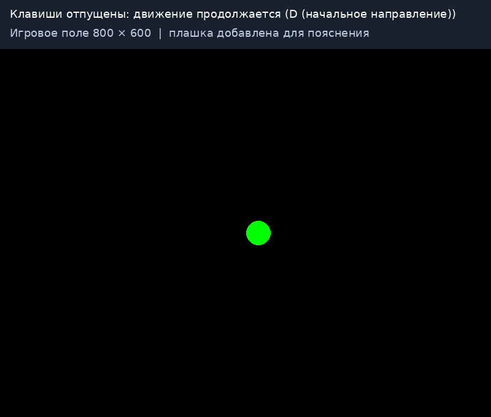

# Урок 5. Практика: табло, светофор и управление движением

Три самостоятельные программы: цифры из семи сегментов, автоматический светофор и непрерывное движение круга с поворотами по WASD. Подготовка: состояние, отсчет времени и скорость по двум осям.

## Степ 1. Подготовка: рисунок зависит от состояния

Ты уже умеешь рисовать фигуры, двигать их и реагировать на отдельные нажатия. Теперь соберем три самостоятельные программы. Перед каждой задачей разберем прием, который поможет ее решить.

Работай на своем компьютере с установленным Pygame. Для каждой задачи создай отдельный файл `.py`. Во всех программах обрабатывай `pygame.QUIT`, очищай фон перед рисованием и показывай готовый кадр через `pygame.display.update()`.

Вспомни программу с двумя квадратами: **нажатие меняет состояние, а игровой цикл рисует это состояние снова и снова**. Для табло состоянием станет выбранная цифра. До `while` задай `digit = 0`, а в обработчике нажатий меняй ее:

```python
if event.type == pygame.KEYDOWN:
    if event.key == pygame.K_1:
        digit = 1
    elif event.key == pygame.K_2:
        digit = 2
```

Это фрагмент внутри `for event in events`. У цифровых клавиш верхнего ряда имена `pygame.K_0`, `pygame.K_1`, …, `pygame.K_9`. Дополни обработчик сам. После выхода из `for` нарисуй все сегменты в зависимости от `digit`.

Сегмент — небольшой прямоугольник. Вызов `pygame.draw.rect(screen, color, (x, y, width, height))` задает его цвет, левый верхний угол, ширину и высоту. У горизонтального сегмента ширина больше высоты, у вертикального — наоборот.

Сначала нарисуй все семь сегментов одним цветом. Затем научись показывать одну цифру и только после этого подключай клавиши.

> **Состояние живет между кадрами**
>
> Начальную цифру задавай до while. Не сбрасывай ее в начале каждого кадра и не рисуй сегменты только внутри KEYDOWN: после следующей заливки такой рисунок исчезнет.

## Степ 2. Задание 1. Цифровое табло

Создай цифровое табло из **семи прямоугольных сегментов**. Когда пользователь нажимает цифру от 0 до 9, табло показывает ее зелеными сегментами.

### Что должно получиться

1. Окно с черным фоном. Размер выбери сам, например 400 × 600 пикселей.
2. Семь сегментов расположены как у цифры 8: три горизонтальных — сверху, посередине и снизу; четыре вертикальных — слева и справа в верхней и нижней половинах.
3. Включенные сегменты ярко-зеленые, выключенные — темно-зеленые, например `(0, 50, 0)`. Сегменты остаются на своих местах, меняются только их цвета.
4. При запуске показан 0. Клавиши верхнего цифрового ряда 0–9 выбирают новую цифру. После отпускания клавиши она остается на экране до следующего выбора.
5. Другие клавиши ничего не меняют. Крестик закрывает окно.

Для проверки обозначим сегменты буквами: `a` — верхний, `b` — правый верхний, `c` — правый нижний, `d` — нижний, `e` — левый нижний, `f` — левый верхний, `g` — средний. Эти буквы нужны для сверки рисунка; выводить их в окне не требуется.

| Цифра | Какие сегменты включены |
| --- | --- |
| 0 | a, b, c, d, e, f |
| 1 | b, c |
| 2 | a, b, d, e, g |
| 3 | a, b, c, d, g |
| 4 | b, c, f, g |
| 5 | a, c, d, f, g |
| 6 | a, c, d, e, f, g |
| 7 | a, b, c |
| 8 | a, b, c, d, e, f, g |
| 9 | a, b, c, d, f, g |

Пришли файл `.py`. Координаты и способ выбора цветов подбери самостоятельно. Готовую таблицу можно использовать как подсказку; словари для решения не обязательны — достаточно условий.



Цифры 0–9 и переход 8 → 1 → 0. Клавиша выбирает цифру, после отпускания рисунок сохраняется.

## Степ 3. Подготовка: меняем состояние по времени

В следующей задаче сигналы будут переключаться сами. Сделаем простой таймер — обычную переменную `timer`, которая считает кадры до переключения.

До `while` запишем `timer = 120`. На каждом проходе цикла будем уменьшать ее на 1. Когда получится 0, изменим цвет и снова запишем в `timer` число 120. Так отсчет начнется заново.

Запусти пример. Прямоугольник сначала темный, затем становится ярким, потом снова темным:

```python
import pygame

pygame.init()
screen = pygame.display.set_mode((800, 600))
clock = pygame.time.Clock()

bright = False
timer = 120

while True:
    events = pygame.event.get()
    for event in events:
        if event.type == pygame.QUIT:
            exit()

    timer -= 1
    if timer == 0:
        bright = not bright
        timer = 120

    screen.fill((0, 0, 0))
    color = (0, 255, 0) if bright else (0, 60, 0)
    pygame.draw.rect(screen, color, (300, 250, 200, 100))
    pygame.display.update()
    clock.tick(60)
```

Разберем, как работает отсчет:

- `timer = 120` до цикла — задаем, сколько кадров ждать.
- `timer -= 1` — в каждом кадре уменьшаем счетчик на 1: 119, 118, 117 и так далее.
- `if timer == 0:` — отсчет закончился, пора менять цвет.
- `bright = not bright` — меняем `False` на `True` или обратно.
- `timer = 120` внутри `if` — снова запускаем отсчет. Эту строку выполняем только после переключения.

`color = ... if bright else ...` выбирает яркий цвет, если `bright` равно `True`, иначе темный. Этот выбор можно записать и обычным `if` / `else`.

Чтобы цикл не работал слишком быстро, до `while` создаем `clock = pygame.time.Clock()`, а в конце каждого кадра вызываем `clock.tick(60)`. Так программа будет показывать не больше примерно 60 кадров в секунду. При такой частоте 120 кадров — это около двух секунд, а 60 кадров — около одной. Если компьютер работает медленнее, ждать придется дольше: наш таймер считает кадры.

**Попробуй сам:** замени оба значения 120 на 60. Цвет станет меняться чаще. Затем сделай так, чтобы яркий прямоугольник оставался на экране 60 кадров, а темный — 180. Для этого после смены цвета задавай новое значение `timer` в зависимости от `bright`.

> **Один кадр — один шаг отсчета**
>
> Строка timer -= 1 должна находиться внутри while, но снаружи for event in events. Тогда отсчет продолжается даже без нажатий. Не задавай timer = 120 в начале каждого кадра, иначе счетчик не дойдет до нуля.

## Степ 4. Задание 2. Автоматический светофор

Создай светофор: прямоугольный корпус и три круга внутри — красный сверху, желтый посередине, зеленый снизу. Программа сама переключает сигналы по кругу.

### Что должно получиться

1. Все три круга видны постоянно. Выключенные сигналы тусклые, включенные — яркие. Например, для красного можно взять `(60, 0, 0)` и `(255, 0, 0)`. Аналогично подбери пары для желтого и зеленого.
2. Сразу после запуска горит только красный. Затем повторяется последовательность: **красный → красный и желтый вместе → зеленый → желтый → красный**.
3. Красный и зеленый горят по 120 кадров, красный с желтым вместе и отдельно желтый — по 60 кадров. При `clock.tick(60)` это примерно 2 и 1 секунда.
4. На стадии «красный и желтый» яркими становятся два круга одновременно. В остальных стадиях яркий только один круг.
5. Сигналы переключаются без нажатий. Окно можно закрыть на любой стадии, в том числе между переключениями.

Размер окна, размеры корпуса и координаты кругов выбери сам. Круги должны целиком помещаться внутри корпуса и не перекрывать друг друга.



Красный — 2 с → красный и желтый — 1 с → зеленый — 2 с → желтый — 1 с. Затем цикл повторяется.

### Подсказка

Сначала нарисуй корпус и три тусклых круга. Заведи переменную `state`: пусть 0 означает красный, 1 — красный с желтым, 2 — зеленый, 3 — желтый. По ее значению выбирай, какие круги сделать яркими.

Заведи `timer` и уменьшай его на 1 в каждом кадре. Когда он станет равен 0, переходи к следующему значению `state`. После 3 снова должно идти 0. Для нового сигнала заново задай `timer`: 120 для красного или зеленого, 60 для остальных вариантов.

## Степ 5. Подготовка: запоминаем направление движения

В прошлом уроке координата менялась внутри `KEYDOWN`: одно нажатие давало один шаг. Теперь нажатие будет выбирать **направление**, а координаты будут меняться в каждом кадре.

Для этого нужны две переменные: `vx` — изменение `x` за кадр, `vy` — изменение `y` за кадр. Например, `vx = 3`, `vy = 0` означает движение вправо на 3 пикселя за кадр.

До `while` задай координаты и начальное направление:

```python
x = 400
y = 300
vx = 3
vy = 0
```

Внутри `while`, **после всего `for event in events`**, но перед рисованием, обновляй координаты:

```python
x += vx
y += vy
```

Эти две строки должны выполняться даже в кадре без событий. Иначе движение снова будет зависеть от количества нажатий.

| Направление | vx | vy |
| --- | --- | --- |
| Вправо | 3 | 0 |
| Влево | −3 | 0 |
| Вниз | 0 | 3 |
| Вверх | 0 | −3 |

По нажатию выбирай **оба** значения. Например, если круг двигался вправо, а теперь должен идти вверх, нужно обнулить `vx` и сделать `vy` отрицательным. Если изменить только `vy`, круг пойдет по диагонали.

Для последней задачи используй `Clock` и `tick(60)` из предыдущего примера. При 60 кадрах в секунду шаг 3 дает примерно 180 пикселей в секунду. Если кадров меньше, движение будет медленнее; для этой практики достаточно такого способа.

**Проверь понимание:** что произойдет после отпускания клавиши? `vx` и `vy` сохранятся, поэтому движение продолжится. Где должны стоять `x += vx` и `y += vy`? Внутри `while`, снаружи `for` и снаружи проверки `KEYDOWN`.

> **Нажатие выбирает, цикл перемещает**
>
> Используй pygame.KEYDOWN и event.key. В обработчике выбирай vx и vy, а координаты обновляй после обработки событий.

## Степ 6. Задание 3. Круг поворачивает по WASD

Создай программу, в которой зеленый круг движется постоянно, а клавиши W, A, S, D меняют направление его движения.

### Что должно получиться

1. Окно размером **800 × 600** пикселей, черный фон. Зеленый круг `(0, 255, 0)` с радиусом **20** пикселей.
2. При запуске центр круга находится в `(400, 300)`, круг сразу движется вправо. Шаг — 3 пикселя за кадр, ограничение — `clock.tick(60)`.
3. Одно нажатие задает новое направление: **W — вверх, A — влево, S — вниз, D — вправо**. Используй `pygame.K_w`, `pygame.K_a`, `pygame.K_s`, `pygame.K_d`. Переключись на английскую раскладку.
4. После отпускания клавиши круг продолжает двигаться в выбранном направлении. При повороте меняется направление, а положение сохраняется.
5. Движение только по горизонтали или вертикали. После смены направления диагонали быть не должно. Повтор той же клавиши не ускоряет круг, другие клавиши ничего не меняют.
6. Следа от старых кадров нет, крестик закрывает окно.

Поворачивай до края окна, чтобы круг оставался виден. Обработку границ здесь добавлять не обязательно. Если хочешь усложнить задачу, вспомни урок движения и добавь появление с противоположной стороны окна; это дополнительная часть.

Пришли файл `.py`. В GIF показан пример маршрута; повторять точные моменты поворотов не требуется. Отдельная плашка над игровым полем поясняет нажатия, в своей программе рисовать ее не нужно.



Круг движется сам. Короткие нажатия S, A, W, D меняют направление; после отпускания движение продолжается. При повторе GIF маршрут начинается заново.
